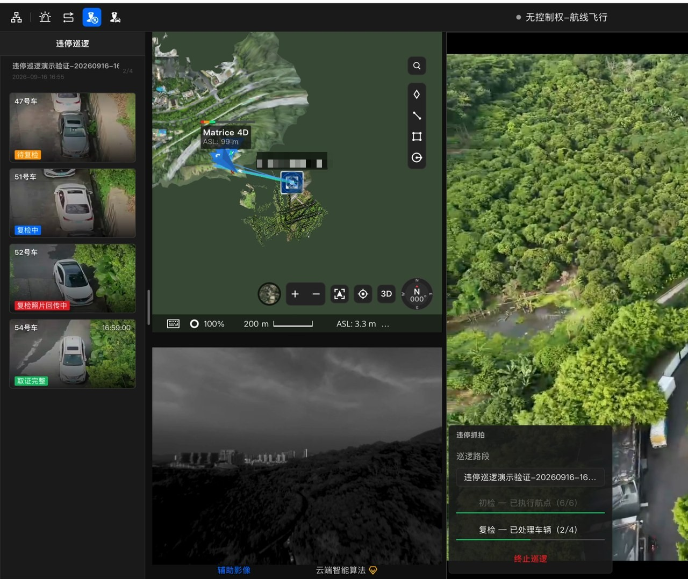
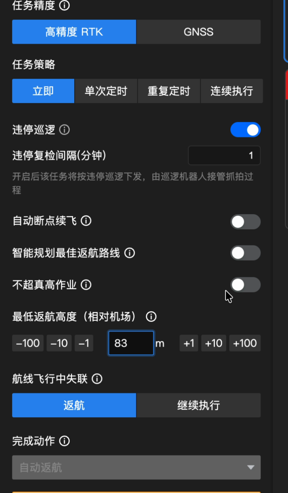
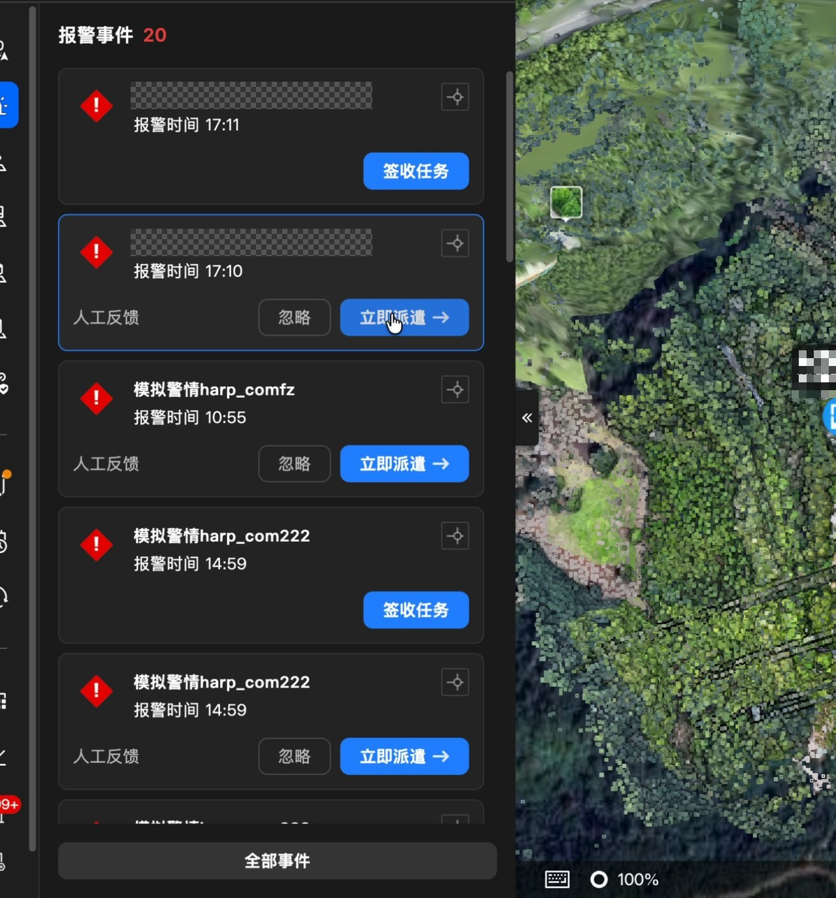
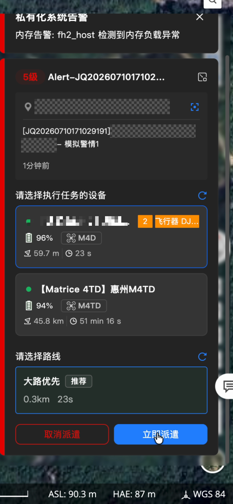

# 典型场景

插件适合把一项业务接到司空已有的页面上，或者把业务逻辑放到服务端执行。下面用三个场景说明“插件能做什么”，每个场景只讲用户旅途和前后端分工；完整操作流程见对应案例页。

## 场景一：违停巡逻

用户在驾驶舱示教一条路段，在计划库配置巡逻；任务起飞后，驾驶舱显示初检、复检进度和车辆照片，最后由操作员决定返航或继续人工控制。

| 运行侧 | 插件贡献 |
| --- | --- |
| 前端 | 驾驶舱工具栏入口、左下角进度面板、车辆列表、照片页签；计划表单中的巡逻配置 |
| 后端 | 巡逻流程、任务下发、记录与照片状态 |

*违停巡逻进行中：左侧为车辆卡片，左下角为初检/复检进度。*

*任务策略之后的“违停巡逻”区域，随计划一起校验和提交。*

完整七步流程、截图和边界见[违停巡逻完整案例](./30.detailed-guide/50.examples/55.patrol-case.md)。

## 场景二：事故快处

项目页面接收并签收警情，消息卡片选择设备和路线，后端校验后下发任务，驾驶舱进入对应现场。

| 运行侧 | 插件贡献 |
| --- | --- |
| 前端 | 项目侧栏入口、警情列表、消息派遣卡、驾驶舱告警卡 |
| 后端 | 警情接口、设备/路线校验、任务下发 |

*报警事件列表：已签收的记录提供“立即派遣”，未签收的记录显示“签收任务”。*

*派遣卡停在确认前：已选一台空闲设备和一条推荐路线，等待“立即派遣”。*

这个场景的重点不是界面数量，而是同一份警情在项目、消息和驾驶舱之间传递。跨宿主不共享内存变量；需要短期协作时用插件服务，需要持久化时走配套后端。

## 场景三：现场问题

在驾驶舱面板上报现场问题，后端保存并返回列表；用户可以在面板里筛选、签收和完成。

| 运行侧 | 插件贡献 |
| --- | --- |
| 前端 | 面板、输入框、列表、筛选和错误提示 |
| 后端 | 创建/查询/更新接口、数据存储、状态流转 |

这个场景最适合作为第一个全栈练习：它包含一次完整的“界面 → 接口 → 存储 → 读回”，也能验证失败提示和幂等。按[全栈闭环](./10.quick-start/30.fullstack-plugin.md)开始。

## 共同边界

- 插件通过公开扩展点和 API 扩展产品，不修改司空源码。
- 前端界面运行在宿主页面里，ShadowRoot 只隔离 UI/CSS，不是 JavaScript 安全沙箱。
- 入口业务网络走 `ctx.apiCall` / `ctx.ws`，不能绕过受管通道。
- 后端脚本运行在同步沙箱中，飞行控制只通过流程受控步执行。
- 本地调试页面和 HTTP 模拟器用于快速反馈；真实宿主、后端、流程和设备必须在目标环境验证。

想看插件由哪些部分组成、一次请求如何穿过前后端，回到[产品简介](./README.md)；想直接动手，进入[快速开始](./10.quick-start/00.index.md)。
