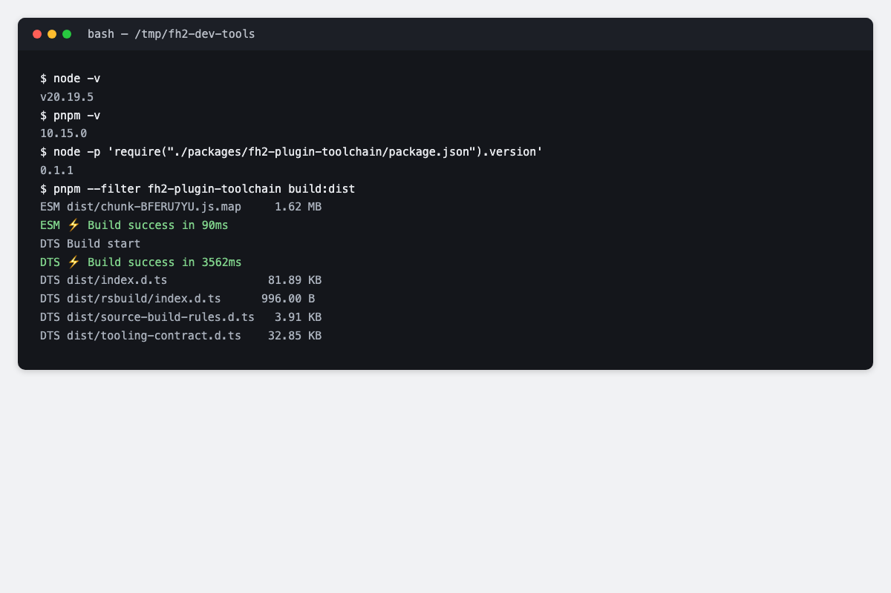
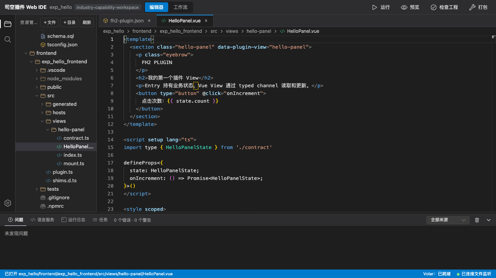
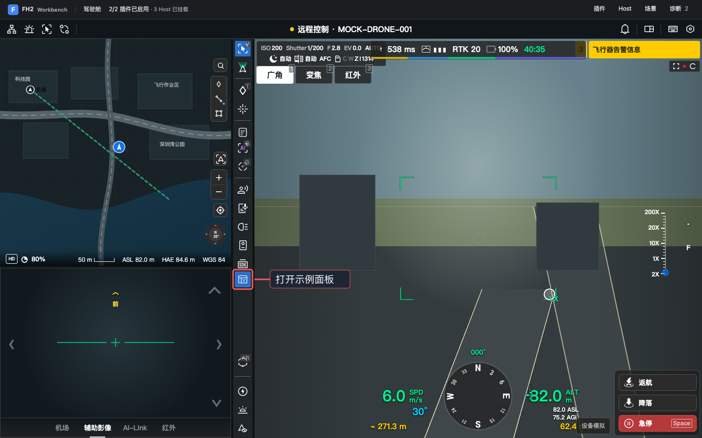
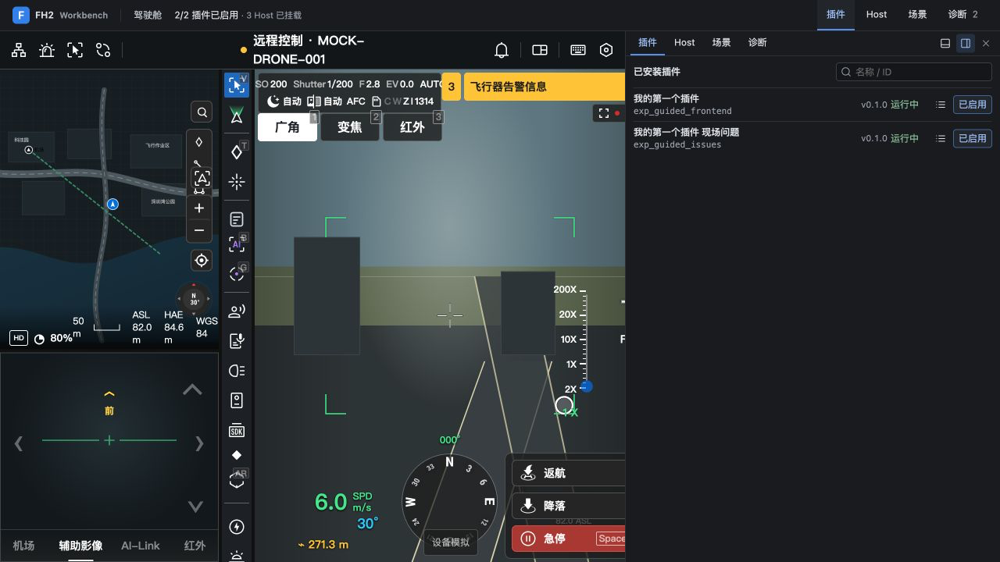
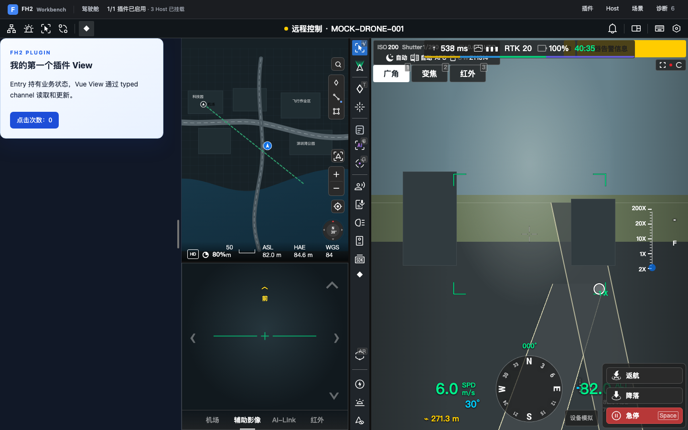
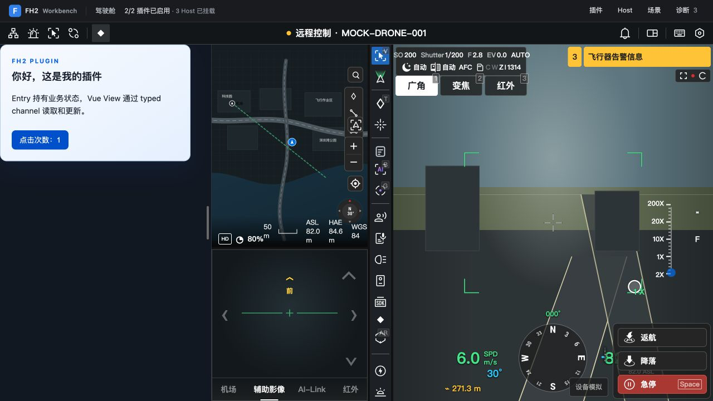
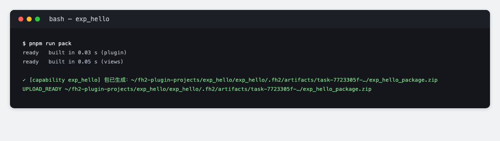

# 第一个插件

创建一个在本地驾驶舱运行的插件：打开面板、修改标题，再校验并打包。无需真实设备或司空账号。

源码：<https://github.com/dji-sdk/FlightHub-2-Plugin>（`Download ZIP` 解压后进入目录，或 `git clone`）。

准备插件开发工具完整源码、Node.js **20.19 或更高**、pnpm **10.15.0**、编辑器和浏览器。SDK 随源码提供。本页命令使用 macOS / Linux 的 Bash 或 Zsh，调试端口为 **5176**。环境配置见[环境准备](../30.detailed-guide/20.development/40.hands-on/10.environment-preparation.md)。

## 1. 准备开发工具

在解压后的开发工具根目录打开终端，依次执行：

```sh
export FH2_TOOLS="$(pwd -P)"
node --version
pnpm --version
pnpm install --frozen-lockfile
pnpm build:tooling
node "$FH2_TOOLS/packages/fh2-plugin-toolchain/bin/fh2-plugin.mjs" create --version
```

确认版本符合要求，构建成功。



在当前终端定义短命令，后面直接使用 `fh2-plugin`：

```sh
fh2-plugin() { node "$FH2_TOOLS/packages/fh2-plugin-toolchain/bin/fh2-plugin.mjs" "$@"; }
```

## 2. 创建工作区

继续在同一终端执行：

```sh
mkdir -p "$HOME/fh2-plugin-projects"
cd "$HOME/fh2-plugin-projects"
fh2-plugin create
```

按提示填写，输入后按回车：

| 向导问什么 | 本教程填写什么 |
| --- | --- |
| 工程类型 | `0`（完整能力工作区，包含前后端示例） |
| 工作区目录 | `exp_hello`，须不存在或为空 |
| 名称 | `我的第一个插件` |
| 包管理器 | `pnpm` |
| 是否立即安装依赖 | `是` |

看到“依赖已安装”和“安装后类型复验通过”后，进入工作区：

```sh
cd exp_hello
```

后面的命令都在**外层 `exp_hello/`**（有 `package.json` 和 `packages.json`）执行。内层同名目录保存插件源码。



## 3. 启动驾驶舱，打开插件面板

在外层工作区根 `exp_hello/` 执行，保持命令运行：

```sh
pnpm run dev:cockpit
```

打开终端打印的**完整地址**。在顶部“插件”面板确认 `exp_hello_frontend` 已启用，再点击**直播左侧竖排工具栏**中的“打开示例面板”按钮。





左侧面板标题应为“我的第一个插件 View”。初始按钮显示“点击次数：0”。



点击按钮后应变为“点击次数：1”。



## 4. 修改文字，保存后看更新

打开 `exp_hello/frontend/exp_hello_frontend/src/views/hello-panel/HelloPanel.vue`，找到标题：

```vue
<h2>我的第一个插件 View</h2>
```

改为：

```vue
<h2>你好，这是我的插件</h2>
```

保存并等待重建完成，页面刷新后应显示新标题。若面板收起，再次点击“打开示例面板”。计数保存在内存，刷新后从 0 开始。


## 5. 校验、构建并打包

先在 `dev` 终端按 `Ctrl+C`，等待命令结束。仍在工作区根执行：

```sh
pnpm run generate
pnpm run validate
pnpm run test
pnpm -r --if-present run tsc
pnpm -r --if-present run lint
pnpm run build
pnpm run pack
```

终端最后打印 `UPLOAD_READY` 和 ZIP 路径，这就是可以上传的安装包，包内包含本工程的前端和后端示例。



要装到司空里看效果，按[安装、升级与回滚](../30.detailed-guide/60.delivery-and-security/50.installation-and-upgrade.md#上传与安装)上传、安装并回滚；包结构见[行业包构建与打包](../30.detailed-guide/60.delivery-and-security/20.industry-package.md)。

接下来读[开发指南](../30.detailed-guide/20.development/00.index.md)、[构建与交付](../30.detailed-guide/60.delivery-and-security/00.index.md)，或查[API 与 CLI 参考](../30.detailed-guide/70.api-reference/00.index.md)。
