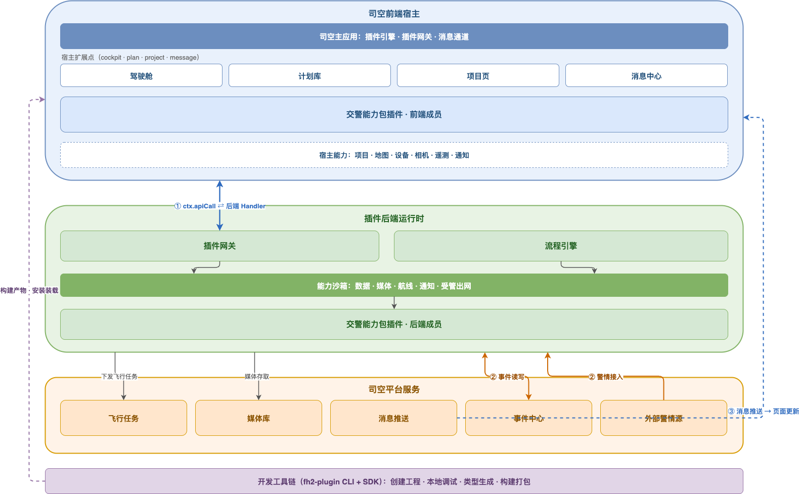

# 平台架构

这一页解释插件从源码到运行经历了什么，以及一次前端请求、一条异步事件和一条流程作业分别走哪条链路。遇到“插件没加载”“按钮没出现”“接口调不通”时，先判断问题落在哪一层。

## 全景

下图以交警能力包为例：前端成员跑在四个宿主里，后端成员跑在插件后端运行时里，两边通过插件网关通信，底部是开发工具链。



*看图记住三段：上面是宿主和你提交的界面，中间是后端运行时与能力沙箱，下面是司空自己的平台服务。*

把图上的框对上工程里的文件：

- **前端成员**：Entry（`activate`）提交扩展、调 `ctx.apiCall`；View 是 Vue 3 界面，挂在 ShadowRoot 里。
- **后端成员**：`handlers/` 是 HTTP 接口，`events/` 是事件回调，`adapters/` 与 `workflows/` 是流程脚本和编排。
- **能力沙箱**：`store`、`cache`、`media`、`notify`、受管出网等，都要先在清单里申报。

## 从源码到页面

1. **写**：前端成员写清单、入口和界面；后端成员写清单、接口/事件/流程脚本。
2. **构建**：`fh2-plugin build` 校验清单和代码结构，生成前端 `dist/`、后端 `dist/` 和运行时清单。
3. **安装**：宿主登记插件。本地调试页面自动装载；线上由插件管理服务下发。
4. **激活**：进入某个页面时，宿主为声明了该页面扩展点的前端插件创建运行环境，调用 `activate(ctx)`。
5. **呈现**：入口提交扩展（按钮、面板、表单块等），宿主挂到预留位置；View 此时才真正运行。
6. **调用**：前端入口通过 `ctx.apiCall` 调后端；后端按 `pluginId + handler` 找到脚本执行。

同一个前端插件在多个宿主各自激活，入口实例不共享内存变量。短期协作用同插件的跨宿主服务，持久化数据放后端。

## 三条链路

### 1. 一次 HTTP 请求

```text
用户操作
  → View 调用契约方法
  → Entry 执行 ctx.apiCall('/plugin/invoke', { pluginId, handler, input })
  → 插件网关补鉴权、加 /plugin-api 前缀、路由到后端
  → handler 校验输入、读写 store、调用其他能力
  → 返回 { code, message, data }
  → Entry 更新状态，View 重新渲染
```

失败时 `ctx.apiCall` 抛 `PluginError`，不是返回一个失败信封；业务码在 `detail.gatewayCode`。前端必须捕获并显示可重试或降级状态，不能吞成成功。

### 2. 一条事件

```text
平台消息（媒体生成、状态变化等）
  → 后端 events[] 匹配
  → 事件回调校验幂等键
  → 写 store / 启动流程 / 调 connector
  → notify 或前端轮询
  → 前端更新
```

事件是至少一次投递，消费脚本必须幂等。事件不缓存、不重放；订阅之前发生的事件收不到。

### 3. 一条流程作业

```text
触发器（api / schedule / stream / bizNotify / job）
  → 流程步骤和 needs 依赖
  → run_script 调用业务功能，或平台受控步执行高风险动作
  → 等待信号 / 超时 / 重试
  → 流程状态和执行历史
```

下发任务、返航等高风险动作用平台受控步，不向脚本注入飞行函数。流程执行、队列和重试必须在目标环境验证；本地画布和快速预检不执行真实流程。

## 运行边界

| 边界 | 前端 | 后端 |
| --- | --- | --- |
| 运行环境 | 宿主页面中的独立 Entry 环境 + 同 Realm View | 服务端 Worker 同步脚本沙箱 |
| 网络 | 入口走 `ctx.apiCall` / `ctx.ws`；View 不接收上下文 | 能力按 `allowlist` 注入；出网走 `connector.fetch` |
| 权限 | 清单 `permissions` + `capabilities.get()` 判空 | 清单 `allowlist`；未申报对象不存在 |
| 隔离 | ShadowRoot 隔离 UI/CSS，不是 JS 沙箱 | 同步沙箱、无 Node 内置模块、无动态执行 |
| 生命周期 | 宿主激活/卸载，资源由平台回收 | 插件版本装载、流程实例和脚本执行 |

安装审核与代码审核是安全边界；不要用 ShadowRoot 或本地构建成功代替安全审查。

## 后端部分在哪里运行

带后端的插件，脚本运行在插件后端运行时里，不在浏览器里。前端 `ctx.apiCall` 把请求经插件网关送到后端，后端按 `{pluginId, handler}` 找到对应脚本执行。细节见[后端插件的结构](../20.development/20.backend/00.package-structure.md)和[后端能力总览](../30.features/60.backend-capabilities/10.overview.md)。

## 验证你理解了

- 不同插件 A 和 B 能通过插件服务互相调用吗？不能；服务按插件 ID 隔离。
- 同一插件在项目和驾驶舱的入口能共享内存变量吗？不能；短期协作用服务，持久化用后端。
- 为什么 View 拿不到入口的 `PluginContext`？这是 API 分工，不是 JavaScript 沙箱保证。
- 本地 HTTP 模拟器通过，能证明生产网关和数据库可用吗？不能；目标环境另验。
