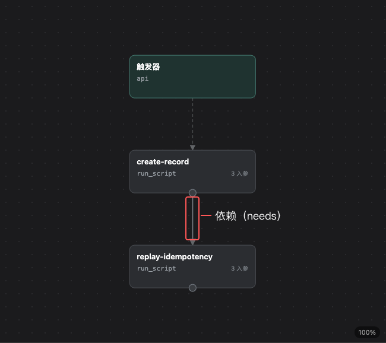
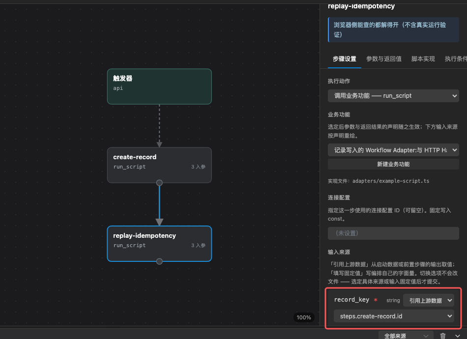

# 流程编排练习（DAG）

当业务需要多步执行、等待外部信号、重试或下发飞行任务时，用后端流程编排，而不是在脚本里写长循环。这一页把“编辑 → 快速预检 → 目标环境验证”走一遍；画布和本地预检都不执行真实流程。概念和 DSL 写法见[流程编排](./60.workflow.md)。

## DAG 是什么：先看一个两步例子

DAG 是「有向无环图」（Directed Acyclic Graph）：**节点是一项步骤，箭头表示前后依赖，依赖不能绕回已经经过的节点**。画布用这张图说明哪些步骤要先完成，后面的步骤才能开始。

例如，模板的 `example-flow` 做两件事：先创建一条记录，再用同一记录键写一次，检查不会重复创建。

```text
输入：记录键 demo-001、标题「首次巡检」
    ↓
create-record：创建记录
    ↓ 依赖前一步，并读取它返回的记录键
replay-idempotency：同一键重放，不重复创建
```

| 节点 | 输入从哪里来 | 正常结果 |
| --- | --- | --- |
| `create-record` | 触发输入中的 `record_key` 和 `title` | 使用新键时创建记录，返回 `id` 和 `created=true` |
| `replay-idempotency` | `record_key` 取前一步的 `id`，`title` 仍取触发输入 | 命中同一条记录，返回 `created=false` |

两个节点调用同一个已登记脚本 `example-script`。第二个节点的 `needs: ["create-record"]` 表示必须等第一步完成；`steps.create-record.id` 则表示读取前一步输出。这里的 `id` 是脚本返回的业务记录键，不是数据库行 ID。

先按[后端插件](../../../10.quick-start/20.backend-plugin.md)创建模板工程，再在其后端成员的 `workflows/example-flow.json` 打开这个流程。文件、脚本和清单登记都由模板提供，不需要新增文件。画布应显示两个节点和一条依赖；本地查看接线即可理解 DAG，表中的业务结果需要在配套存储和流程运行环境就绪后验证。



图示对应 `exp_hello` 模板后端的 `example-flow`：`create-record` 指向 `replay-idempotency`，箭头表示依赖。

## 1. 打开工作流画布

先按[Web IDE：打开工程与保存改动](../../40.debug-and-test/12.web-ide.md)启动 Web IDE，并打开后端插件根：

```bash
fh2-plugin serve --root "<后端插件目录>"
```

在「工作流」视图选择已有流程，或点「新建工作流…」。流程文件必须是 `.json`，新建后先存在编辑器内存里，保存才落盘，而且不会自动加入后端清单的 `flows[]`。

## 2. 添加步骤和依赖

最小流程包含：

1. 一个触发方式（`api`、`schedule`、`stream`、`bizNotify` 或 `job`）。
2. 一个 `run_script` 步骤，调用已登记的业务功能。
3. 需要下发任务时，使用平台受控步（例如 `dispatch_mission`），不要试图在脚本里直接飞控。

连接节点依赖端口形成 `needs`。引用某一步输出前，该步骤必须在当前节点的依赖链里；画一条视觉连线不等于可以任意全局取值。

选中模板的 `replay-idempotency`，在参数检查器核对 `record_key` 的引用来源。对应文件片段如下，不需要为配图改写流程：

```json
{
  "id": "replay-idempotency",
  "action": "run_script",
  "needs": ["create-record"],
  "inputs": {
    "script": { "const": "example-script" },
    "record_key": { "from": "steps.create-record.id" },
    "title": { "from": "trigger.title" }
  }
}
```



`record_key` 取 `steps.create-record.id`，`title` 仍取 `trigger.title`；`needs` 必须包含 `create-record`。

## 3. 快速预检

点「检查」只做内存结构和引用的快速反馈，不保存文件，也不执行流程。它会报告空步骤、依赖成环、入参类型不匹配、等待信号缺配置等问题。

预检通过不等于可部署：

- 当前没有同版本权威流程校验器。
- 服务端快速预检默认使用内置目录，不一定与目标后端知识包一致。
- 真实流程执行、队列、重试和超时必须在目标环境验证。

## 4. 保存、登记和打包

按顺序做，没有一键完成全部步骤的按钮：

1. 画布「保存」，核对实际写入的文件和回执。
2. 在源码编辑器确认后端 `fh2-plugin.json` 的 `flows[]` 已登记该流程。
3. 保存清单，再运行工程校验。
4. 需要交付包时，在后端成员根打包；要生成完整上传包，按[能力版本发布](../../60.delivery-and-security/40.capability-release.md)从能力或工作区根执行。

## 5. 目标环境验证

至少验证：

- 正常完成。
- 预期失败/跳过。
- 等待信号和超时。
- 重复消息/重复请求的幂等。
- 依赖能力不可用时的降级。

保留业务 ID、流程 ID、失败步骤和时间范围。本地 `dev` 只模拟 HTTP/事件，不执行真实 Workflow。

## 继续阅读

- [流程编排](./60.workflow.md)：什么时候用流程、步骤和依赖怎么写
- [工作流编辑器：节点、接线与交付](../../40.debug-and-test/14.workflow-editor.md)
- [流程编排语言](../../70.api-reference/20.backend/60.workflow-dsl.md)
