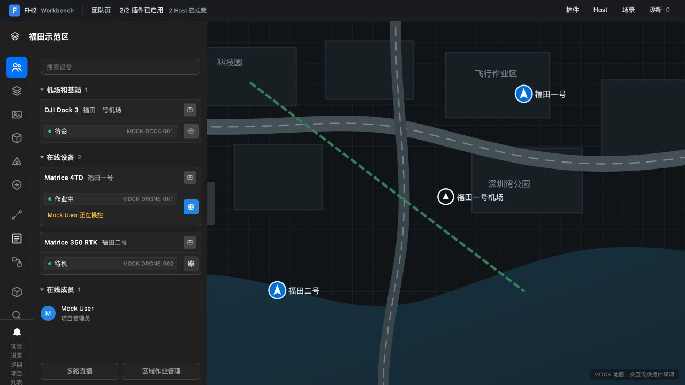
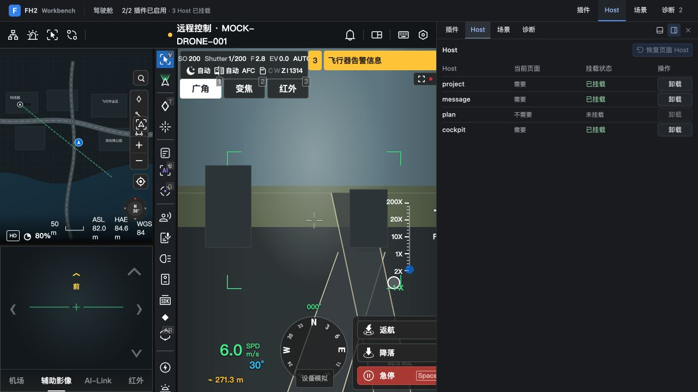
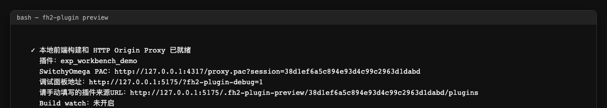
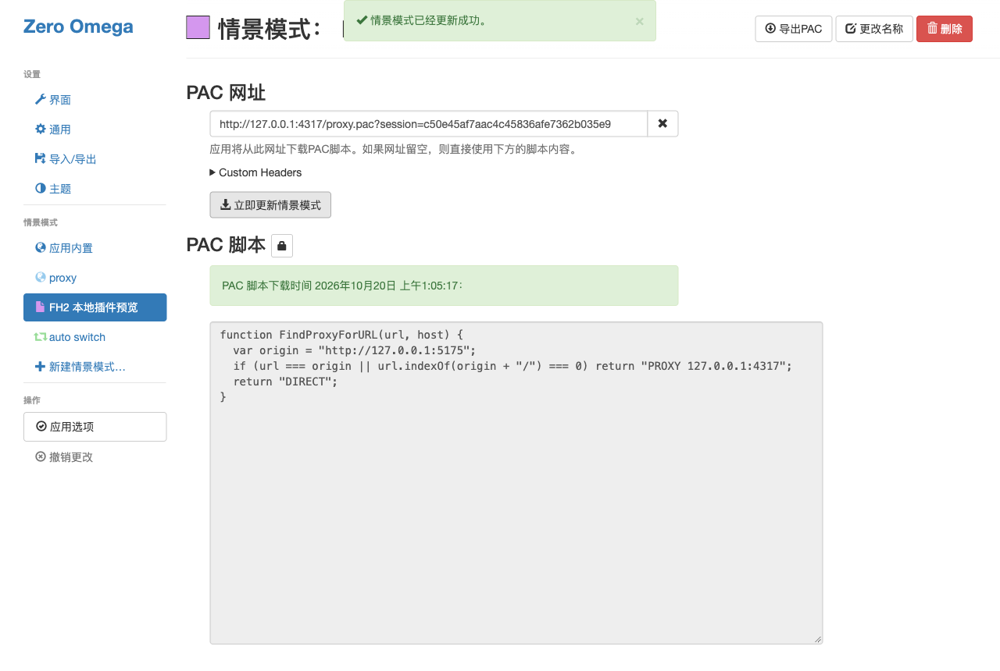
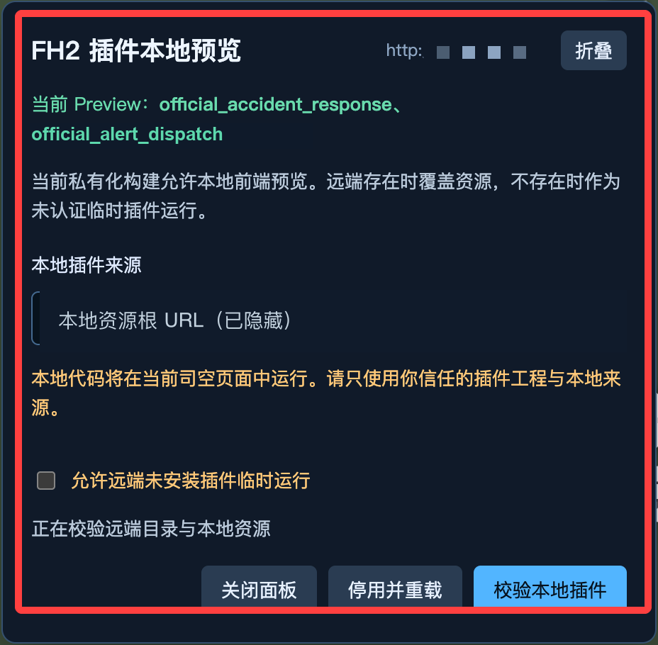

# 本地开发

本地开发有几条链路：有的模拟宿主，有的连接真实环境。先选对链路，再解读结果。本文适用当前发行版；Web IDE、流程画布和 MCP 是可选工具，不替代目标环境验收。

## 四条链路怎么选

| 链路 | 怎么启动 | 能验证 | 不能验证 |
| --- | --- | --- | --- |
| 本地调试页面（模拟宿主） | `fh2-plugin dev` | 清单装载、目标宿主激活、扩展点、界面、通信、资源释放、模拟网络 | 真实账号权限、设备结果、生产网络与后端队列语义 |
| 驾驶舱模拟器 | `fh2-plugin dev cockpit`，选择插件或能力根 | 驾驶舱布局、工具栏/面板/直播叠加层、模拟能力交互 | 真机协议、飞控结果、实际媒体质量 |
| 真实环境预览 | `fh2-plugin preview` | 本地产物在真实宿主、真实登录态、真实能力下的行为 | 未实际执行的设备动作与后端分支 |
| 已部署后端测试环境 | 使用部署方提供的环境入口和凭据 | 后端运行时、真实存储、流程执行、消息投递与重试 | 未实际执行的设备动作或未接通的能力提供方 |

> 本地调试页面由 `fh2-plugin dev` 启动，用于模拟宿主，实现了平台的装载协议和一批模拟能力。
>
> 模拟数据只能证明"插件对模拟契约的处理正确"。本地调试页面里相机、遥测或飞行命令返回成功，不等于真机行为通过。

## 环境准备

本地开发需要 Node.js 和浏览器。开发者工具初始化需要 Node.js `>=20.19`（推荐 22 LTS 及以上），pnpm 由 Corepack 按工具锁定版本自动准备。插件工程再沿用创建时选择的包管理器和生成配置。先取得获授权的开发者工具并完成构建/CLI 注册，检查 `fh2-plugin create --version`；本地 HTTP 模拟器随工具链启动，无需部署后端基础服务。

具体安装步骤见[环境准备](../20.development/40.hands-on/10.environment-preparation.md)。

## 最短前端循环

在已生成的 pnpm 工程工作区根（有 `package.json`）执行；能力模板外层还有 `packages.json`，脚本通过 `--root` 选择能力子目录。开发者工具根目录不能当作插件工作区：

```bash
pnpm install
pnpm run generate    # 生成类型
pnpm run validate    # 校验清单与代码一致
pnpm run build       # 构建
pnpm run dev         # 启动本地调试页面
```

`pnpm run dev` 会先构建并监听源码。前端或含前端的能力工程启动本地调试页面，默认端口 `5175`；独立后端只启动本地调试网关。都以终端实际输出为准。

常用变体：

```bash
pnpm exec fh2-plugin dev --root "<能力子目录>" --frontend-only
pnpm exec fh2-plugin dev cockpit --root "<能力子目录>"
pnpm exec fh2-plugin dev --root "<插件或能力子目录>" --no-watch --port 5180
```

含 `packages.json` 的行业工作区根不支持不选能力就直接 CLI `dev`。使用上面的 `--root <能力子目录>`，或在含 **`package.json` + `packages.json`** 的外层根运行已有的 `pnpm run dev`。新生成工作区还可在这个根运行 `pnpm run dev:cockpit`，根脚本显式选择内层能力；旧工程没有该脚本时，保留上面的 `pnpm exec fh2-plugin dev cockpit --root "<能力子目录>"`。

前端成员的同名 `dev:cockpit` 脚本只针对该成员，不代表完整能力链路。不要在 `frontend/` 父目录或成员 `src/` 中猜测脚本归属；明确选外层根。已有 pnpm 工作区内可用 `pnpm -w run dev:cockpit` 明确运行根脚本，不套用到其他包管理器。`cockpit` 必须放在 CLI 选项之前，且运行结果仍包含 `project+message+cockpit` 三个宿主。

前端重建成功会刷新页面；能力内后端重建成功只重载本地后端。构建失败先修终端第一条诊断，已有页面可能仍展示上一份产物。独立后端没有页面错误提示，必须看终端。`--no-watch` 不再重建，但服务仍运行到手动停止。

## 使用本地调试页面

1. 打开终端打印的完整地址，保留组织/项目路径、设备参数和 `#` 后的路由，不只复制端口根地址。
2. 从顶部开发工具栏打开「插件」，检查插件启用状态；按需保存配置并重载。
3. 打开「Host」核对实际挂载状态。团队/插件页是 `project+message`；计划页再加 `plan`；驾驶舱页再加 `cockpit`。页面不可见不代表宿主卸载。
4. 打开「场景」发送模拟事件；打开「诊断」按插件、宿主、阶段或错误码定位。验证释放时在「Host」实际卸载对应宿主，再看资源快照。





工具面板可停靠右侧或底部并调整大小；浏览器允许本地存储时会记住布局。模拟场景的成功只能证明本地契约处理，不证明真实设备动作。

## 本地全栈循环

在能力根运行，工程包含后端且未用 `--frontend-only` 时，`dev` 会构建后端并启动本地 HTTP 模拟器。`--backend-only` 可只运行本地后端；单个成员筛选使用能力根的 `--frontend` / `--backend`：

```text
前端 ctx.apiCall('/plugin/invoke')
  → 本地 HTTP 模拟器（模拟路由与鉴权）
  → 构建后的 handlers/events 脚本
  → 内存数据存储
  → { code, message, data }
```

这条链路执行插件的接口/事件脚本，但存储和事件投递是本地内存实现，不等价于真实网关、数据库、消息投递或流程运行。`build` / `pack` 都不启动服务；本地 `dev` 不执行流程。错误码、事件形状和排序差异见[已知限制](./30.backend-debugging.md#已知限制)。

可选 `--gateway-target <origin>` 只代理固定 HTTP 网关，需要通过环境变量安全注入 `FH2_DEV_LOGIN_TOKEN`；不打印或提交变量值。本地 WebSocket 与平台事件仍是模拟数据，不会自动接上真实订阅。

## 真实环境预览

本地调试通过后，用 HTTP 预览在获授权的真实宿主里检查前端。目标须是支持插件调试的私有化环境，你还需要登录权限和目标项目访问权限。当前只支持 HTTP：目标只有 HTTPS 时停在这里，不要装证书或关闭校验来绕过。

在已安装依赖的前端插件或能力根执行，地址换成实际 HTTP 项目页，命令不包含凭据：

```bash
pnpm exec fh2-plugin preview --root "<前端插件或能力子目录>" --fh2-url "http://fh2.example.test/project" --no-open
```

1. 等终端打出 PAC、调试面板和「插件来源URL」三类地址，保持进程运行。ready 只说明本地代理和产物就绪。
2. 在代理扩展（如 SwitchyOmega）新建 PAC 情景模式，填入本次 PAC 地址，更新并启用。命令不会改你的浏览器代理。
3. 在同一 HTTP Origin 先登录并进入目标项目，再打开终端打印的调试面板地址。
4. 在面板「本地插件来源」手填本次完整资源根。它不是入口 JS、清单、PAC 或面板地址，也不要复用旧会话。
5. 点「校验本地插件」，核对插件 ID、版本和权限。
6. 勾选「允许远端未安装插件临时运行」，再点「确认并重载」。



*三类地址各有用处：PAC 填进代理，调试面板用来打开页面，资源根手填进面板。*



*填入 PAC 后「应用选项」，再「立即更新情景模式」下载脚本；只有本次目标 Origin 走本地代理。*



*来源 URL 已隐藏；图中正在校验，同意项未勾选。*

同 ID 的远端插件按 `overlay` 覆盖安装清单里已声明的资源（含图标，新增图标要走正常版本升级）；远端没有的按 `temporary` 临时运行。两种情况都只有前端来自本地，后端仍是目标环境已安装版本。

普通页面和 HTTP 接口转发到目标，只有本次会话的插件资源来自本地；代理不是通用代理，不提供 HTTPS 隧道，也不保证 WebSocket 联调。

重建默认监听源码，`--no-watch` 只构建一次；插件 ID 变了要重启预览并重填资源根。其它参数见[工具链命令行参考](../70.api-reference/10.frontend/70.toolchain-cli.md)。

本地代理成功、面板确认、真实宿主激活是三件不同的事；后端流程和设备动作还要单独验。结束时的停用与代理清理见[每轮结束](#每轮结束)。

## 可选开发工具

| 工具 | 适合的任务 | 下一步 |
| --- | --- | --- |
| Web IDE | 打开本地工程、编辑文件、保存冲突处理、运行本地任务 | [启动与保存](./12.web-ide.md) |
| 工作流画布（DAG） | 编辑流程节点、依赖、参数和共享业务功能 | [流程编辑与检查边界](./14.workflow-editor.md) |
| 知识与 MCP | 固定后端检查依据，供 AI 只读检索或显式执行工程任务 | [知识与 MCP](./16.mcp-and-knowledge.md) |

这些工具使用同一份磁盘工程，但有各自的保存、任务及访问边界；不要把 AI 回答或画布变绿当成真实运行结果。

## 已部署后端验证

需要验证流程编排、真实存储或消息投递语义时，使用已有测试环境，由部署方确认接入与服务就绪：

1. 请部署方确认插件已安装、业务表已建、相关能力提供方和队列已就绪，并取得测试入口与授权方式。
2. 使用隔离测试数据，按 `pluginId` / 接口名（`handler`）调用接口；流程按流程名和业务 ID 启动、查询和投递信号。
3. 检查重复调用、重投、流程等待与失败恢复，保留业务 ID、错误码和流程状态；需要日志或消息重放时联系技术支持或部署方。

详细步骤见[后端调试](./30.backend-debugging.md)。真实设备测试另需获批项目与设备，不能用模拟结果替代。

## 每轮结束

- 在本地调试页面实际卸载对应宿主，检查诊断面板资源快照，再用 `Ctrl+C` 关闭 dev。
- 真实预览结束时，先在宿主面板点「停用并重载」，清除本地来源；再停止 preview，关闭临时 PAC 并恢复原代理模式。否则目标访问可能仍依赖已停止的本地服务。
- 确认自己启动的服务和监听退出、端口释放。不要停止别人的进程。
- 关闭 IDE/MCP 前核对未保存文件和仍运行的任务；不要提交 Token、密钥或现场配置。

## 继续阅读

- [前端本地调试](./20.frontend-debugging.md)
- [后端调试](./30.backend-debugging.md)
- [模拟数据与测试数据](./35.mocks-and-fixtures.md)
- [集成测试与 E2E](./40.integration-and-e2e.md)
- [日志与链路追踪](./50.logs-and-traces.md)
- [常见问题排查](./60.troubleshooting.md)
