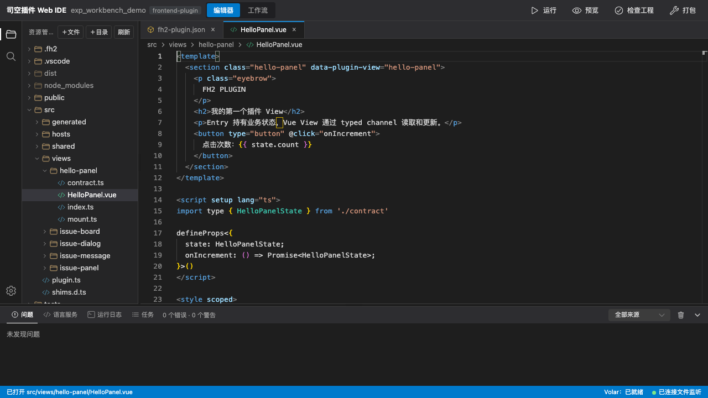
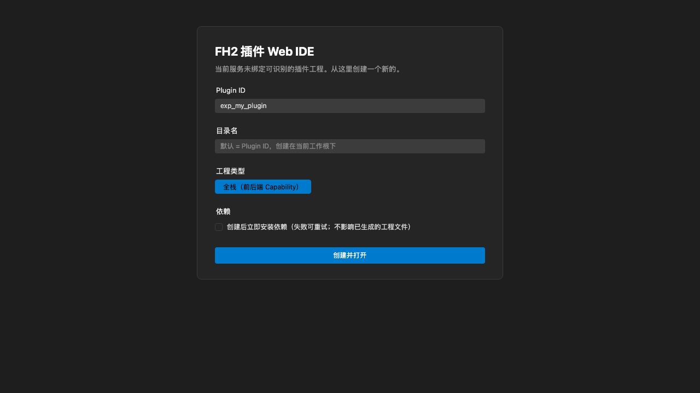
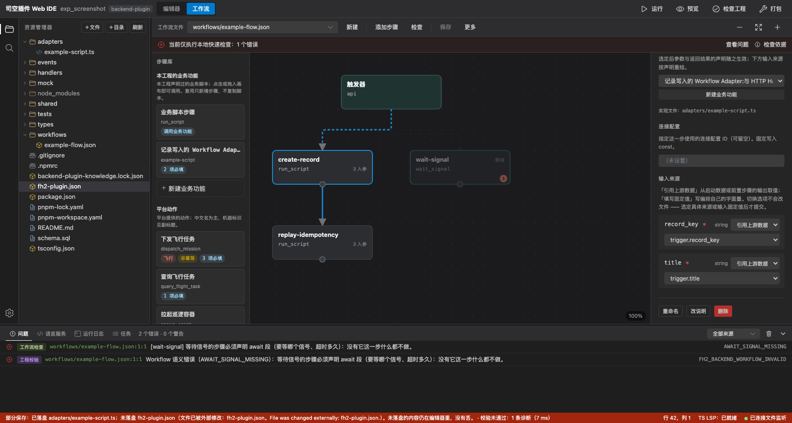
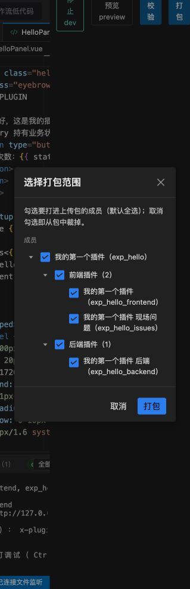
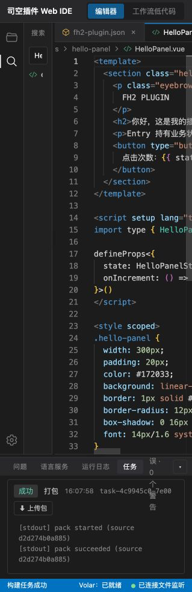

# Web IDE：打开工程与保存改动

Web IDE 用浏览器编辑本地插件工程，并调用本机工具链执行校验、打包和调试任务。本文适用当前发行版，是可选开发路径，不替代命令行、代码审核或目标环境验收。使用前须取得获授权的开发者工具，完成[环境准备](../20.development/40.hands-on/10.environment-preparation.md)；工具链必须包含 Web IDE 页面资源。

## 启动与打开工程

在已注册 CLI 的终端，从工程父目录执行，`--root` 指向已存在的插件工作区或单插件目录：

```bash
fh2-plugin create --version
fh2-plugin serve --root "<已有工程目录>" --no-open
```

打开终端打印的本机地址。未指定端口时随机分配空闲端口，不能传 `--port 0`；需要固定端口时指定 `1..65535` 的整数。临时 token 注入首页、在本次服务进程内有效，终端 URL 不携带它；不要分享页面源码、截图公开 token 或把本机服务作为远程入口。

已识别的工程直接显示编辑器；未识别目录会进入启动中心，启动中心只负责创建新工程。要打开已有工程，重新执行 `fh2-plugin serve --root "<工程目录>"` 指向它。创建成功并打开新工程前，当前工作区有未保存修改时会先要求选择「保存并切换」或「丢弃并切换」；切换后 IDE 清空文档、问题与画布，再按新根重拉文件树。

需要新建时，在启动中心填写 Plugin ID 和目录名；工程类型固定为「全栈（前后端 Capability）」。按需勾选「创建后立即安装依赖」。安装失败/取消会保留工程文件，可选「仍然打开」，但不能把它视为依赖就绪。CLI 注册也不会安装开发 Skill。





## 编辑已有文件

1. 从文件树打开实际源码，确认当前工作区和路径。文件树的新建/重命名/删除会改变磁盘；还支持右键「复制」后到目标目录右键「粘贴」，重名会自动追加 ` (2)`、` (3)`，目录不能粘贴到自身或其子目录。删除不是可撤销的文本编辑。
2. 在主编辑器修改文件。工作流 JSON 可通过文件树右键「在工作流画布中打开」，或切换「工作流」视图选择流程。
3. 文本编辑器按 `Ctrl/Cmd+S` 保存当前文件；默认还会在停止输入约 1 秒后自动保存，可在设置里关闭自动保存（关闭后编辑不再落盘，`Ctrl/Cmd+S` 仍可用）。工作流视图下同一快捷键请求 DAG 保存，不是只保存当前节点。
4. 看状态栏/保存回执，再用磁盘内容核对实际写入。语法和类型提示只说明编辑期检查，不证明业务代码运行成功。

主编辑器和 DAG 的「脚本实现」可显示同一路径的同一份内容，共享撤销、未保存和冲突状态。检查器里打开的脚本现在也会纳入保存计划，但仍以回执里出现的路径为准。

## 保存边界

要保存流程，用画布的「保存」（提示：保存当前工作流，以及它引用的脚本和清单）；它限制在当前流程、所属清单和关联脚本。「更多」菜单里的「保存全部改动（N）」才尝试保存实际收集到的工作区改动。按钮名称不是磁盘完整性证明。

| 情况 | 当前行为与处理 |
| --- | --- |
| 新建虚拟文件 | 首次保存成功即写入磁盘并转为已存在文件；继续编辑再保存正常走写入，不再重复创建。仍须检查两次保存后的内容 |
| 在 DAG 检查器里编辑脚本 | 脚本已纳入保存计划，包括没有独立标签页的检查器脚本；仍须在回执里看到该路径，未出现就不算保存 |
| 输入框里的 DAG 草稿 | 保存前会把光标所在输入框里还没确认的值写进文档；顶部任务入口的保存走同一条路径。需要点「启用」的触发器表单不自动提交 |
| 顶部「检查工程/打包/运行/预览」前保存 | 新文件仍要先读磁盘，可能报 404。先用 DAG 保存新文件，核对回执后再启动任务 |
| 自动保存 | 默认开启，停止输入约 1 秒落盘；切换工作区会丢弃挂起的定时器，已落盘内容不会撤销 |
| 外部删除文件 | 有未保存内容的标签页保留内容并标记磁盘缺失，下次保存按新建重建；干净且无撤销历史的文档直接关闭；有撤销历史的干净文档不静默重灌 |
| 外部编辑造成冲突 | 保存检查磁盘版本，冲突时先比较内存与磁盘并明确处理，不静默覆盖 |
| 部分保存 | 已成功文件已经落盘且不会整批回滚；失败文件保留未保存状态，后续被跳过文件归 `pending` 未执行 |

当前 `FH2_IDE_SAVE_SKIPPED` 表示该项未执行，不应并入普通失败。回执中的 `saved`、`failed`、`conflicted`、`pending` 分别检查；`nothingToSave` 只表示这次计划没有可保存项，不能证明其它未收集文件已落盘。

多文件按顺序尝试写入，不承诺全部成功或全部回滚。已有部分成功时，先核对磁盘及未执行内容，再处理冲突/重试。不要直接关闭页面、重新载入或反复重试整批来掩盖结果未知。



图中是画布上方的「保存」入口和一次真实的部分保存回执：脚本已落盘；插件清单因磁盘被其它进程改写而未落盘（冲突）。已落盘的文件不会因为后面的失败而回滚，未落盘的清单仍留在编辑器里。截图为合成演示工程与合成文件路径。

## 校验、打包与运行

先确认磁盘保存完整，再使用顶部真实入口：

- 「检查工程」先保存全部改动再运行项目校验；不能替代同版本的权威后端流程校验器。开始检查时会先清空上一轮问题，避免旧错误混入。
- 「打包」包含构建和类型检查。能力/行业工作区可选成员，取消成员会从上传包中裁掉；确认范围后等待任务终态。
- 「运行」在可运行目标中选择能力或插件；行业根不会直接作为 CLI dev 目标。运行面板显示状态和日志，运行中同一按钮变为「停止」。
- 「预览」要求填写完整 HTTP 目标项目页并确认加载本地前端。随后仍需按日志配置 PAC、先登录、手填来源和完成宿主确认；IDE 确认不替代宿主同意。

「更多操作」菜单提供「预览/检查工程/打包」的备用入口，行为与顶部按钮一致。问题面板可按来源筛选、清空当前列表，筛选后的计数只统计当前来源；编辑器里新出现的首个错误若不在视口内，会自动滚到该行。

任务面板提供日志、取消和产物下载。已返回任务 ID、状态为运行中或出现下载入口，都不是完整验收结论。检查任务是否 `succeeded`、是否有诊断及 `stale` 标记；构建期间源码变化导致产物过期时，应保存后重新打包。





下载的 zip 是交付物，不会自动上传。真实预览步骤见[本地开发](./10.local-development.md#真实环境预览)，流程登记与交付见[工作流编辑器](./14.workflow-editor.md#保存、登记与交付)。

## 本机访问与结束

`serve --root` 选择初始工作区，不是固定文件系统沙箱或多用户权限系统。服务以启动者的操作系统身份执行任务；临时 token 是本地 API 鉴别，不是司空管理员授权。当前工作区内的文件 API 检查相对路径与符号链接边界，但不能据此认为依赖脚本和构建进程被沙箱隔离。

结束前核对磁盘与未保存内容，停止自己启动的 dev/preview 和任务，再用 `Ctrl+C` 停止 serve。重启服务后使用新的终端地址；不要转发端口或对外开放该服务。

## 继续阅读

- [工作流画布与保存](./14.workflow-editor.md)
- [知识与 MCP](./16.mcp-and-knowledge.md)
- [常见问题排查](./60.troubleshooting.md)
- [工具链命令行参考](../70.api-reference/10.frontend/70.toolchain-cli.md)
