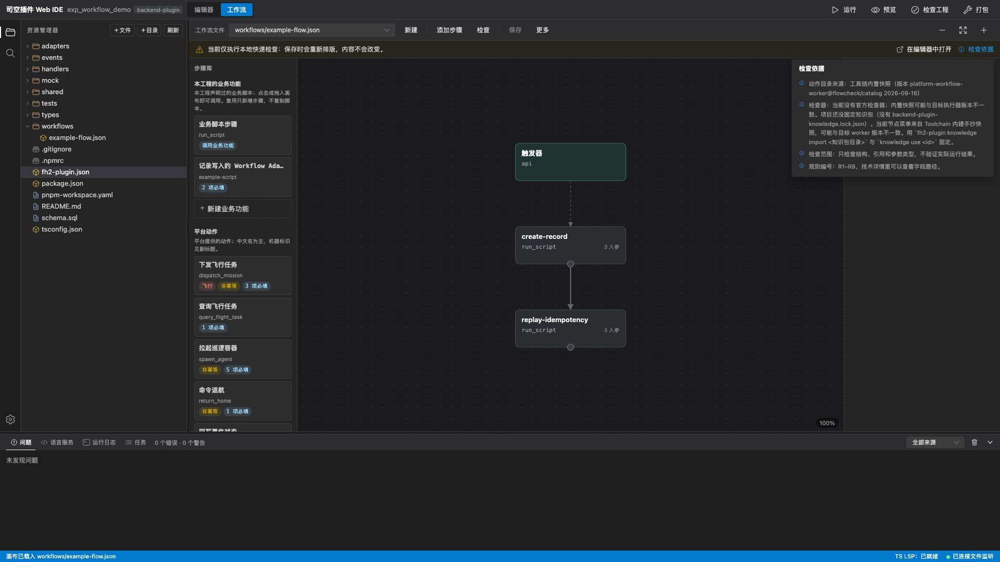
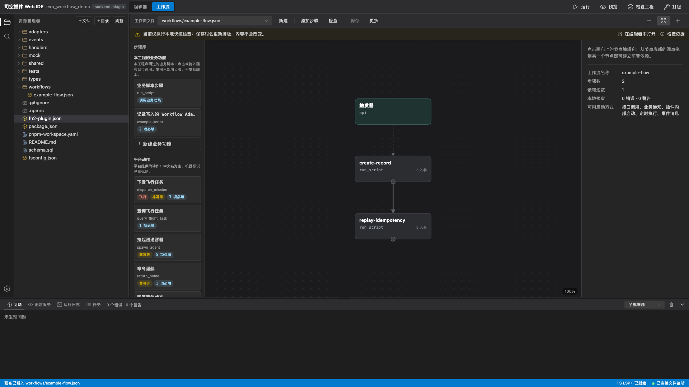
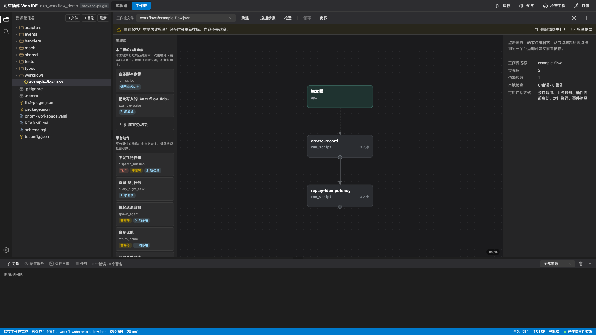

# 工作流编辑器：节点、接线与交付

工作流画布把后端流程 JSON 显示为有向无环图（DAG），用于编辑步骤、依赖、参数和共享业务功能。本文适用当前发行版，是可选编辑工具；画布和本地快速预检不执行真实流程，也不能承诺流程可部署。

使用前完成[Web IDE 环境与启动](./12.web-ide.md)。建议先打开一个实际后端插件根，确认有源码 `fh2-plugin.json`，避免把前端清单或行业工作区误当后端成员。

## 固定检查依据

取得部署方提供、与目标后端版本匹配的知识包。以下命令在已注册 CLI 的终端执行；工程目录与稍后打开的 IDE 根保持一致，知识包路径相对当前终端目录：

```bash
fh2-plugin knowledge import "<后端知识包目录或tar.gz>"
fh2-plugin knowledge use "<导入输出的knowledgeId>" --root "<后端插件目录>"
fh2-plugin knowledge status --root "<后端插件目录>" --json
fh2-plugin serve --root "<后端插件目录>"
```

`import` 只装本机缓存，不改工程选择；`use` 才在该根写入 `backend-plugin-knowledge.lock.json`。把锁与项目一起审查/版本管理；不要手写下载地址、凭据或可执行文件路径进锁。

进入「工作流」视图，点击「检查依据」打开弹层，核对「动作目录」与「检查器」的来源、版本、知识 ID 和状态。未固定或知识不可用时可能回退 `builtin-snapshot`（工具链内置快照），界面会显示原因；有锁但解析失败时，先修复，不能把回退当成版本匹配。

当前 `checkerAvailable` 为 `false`，没有同版本权威流程校验器。节点目录读取固定知识包，不等于服务端快速预检已接入同一知识包或权威校验器；当前服务端预检默认使用内置目录。`status` 没有阻断项也不代表可部署。



图中是未固定知识包时的内置快照提示；实际项目应以自己的知识锁、版本和执行器状态为准。

## 打开或新建流程

用「工作流文件」下拉选择已有 JSON，也可在文件树右键「在工作流画布中打开」。JSON 语法不完整时先在源码编辑器修复，画布不会替你重写半截内容。

点「新建」时填写工作流名称、文件路径和启动方式，按向导补充该方式的必填配置。文件路径相对 IDE 工作区根，必须是 `.json`；以单后端根为例放在 `workflows/`。新建后先存在编辑器内存里，保存才落盘，且不会自动加入后端清单的 `flows[]`。

「更多」中的「刷新画布」按当前编辑器内容重新计算，不读磁盘；「从磁盘重新载入」会比较磁盘版本并提示如何处理未保存内容。两项操作都不保存文件。

## 添加步骤与接线

1. 用「添加步骤」选择平台动作、等待步骤，或调用已有/新建业务功能。已有但未在当前目录中的动作会显示出来，不会自动替换成其它动作。
2. 连接节点依赖端口，形成 `needs` 的执行先后关系。引用某步骤输出前，该步骤必须位于当前节点的依赖链，画一条视觉连线不是任意全局取值。
3. 选中节点，在「步骤设置 / 参数与返回值」为每个输入填写固定值（`const`）或引用（`from`）。引用从 `trigger`、依赖步骤的 `steps` 或 `run` 数据选择；只切换输入模式仍可能是草稿，需填写并确认。
4. 按业务配置「执行条件」、等待信号和超时。检查未保证有值的来源与跳过/失败分支，不把节点变绿当作运行条件就绪。
5. 点「检查」，查看内存结构/引用的快速反馈。快速检查会报告空步骤、步骤 ID 占用 `trigger`、重复 `needs`、`needs` 成环、入参类型不匹配、`await_signal` 缺 `await`、`timeoutSecFrom` 不可解析等问题。通过「问题」面板定位节点或具体输入；该按钮不保存任何文件。

输入、依赖和条件的完整语义见[流程编排](../20.development/20.backend/60.workflow.md)和[流程编排语言](../70.api-reference/20.backend/60.workflow-dsl.md)，不要把本地目录提示当作第二份权威字段表。

使用当前工具栏的「适应窗口」查看完整节点与接线。



## 共享业务功能

三种身份要分开：`scripts[].name` 是可复用功能 ID，`path + entry` 定位源码文件/入口，`steps[].id` 是这一次调用的节点 ID。

- 「调用已有业务功能…」只新增调用节点，不复制脚本或清单条目；每次调用参数在「步骤设置 / 参数与返回值」配置。弹窗右上角 X 或 Esc 只关闭弹窗，只有点「改为新建功能…」才切换到新建分支。
- 「新建业务功能」在内存里准备脚本源码、清单 `scripts[]` 条目和调用节点/接线。它不是已经写盘，也不是注册到目标后端。
- 「参数与返回值」修改共享的 `scripts[].io`，可能影响多个调用方；应用修改只改内存，仍需保存。
- 「脚本实现」编辑共享源码文件，该文件可能包含多个入口。TypeScript 工程生成 `.ts` 命名导出，需经构建；JavaScript 工程生成对应 `.js`。新建模板中的 TODO 会主动报未实现，须先完成实现。

修改共享契约、移动脚本或删除依赖前查看影响范围。画布不支持的配置保留在源码里处理，不为了消除提示删除未知字段。

检查器里编辑的脚本（包括没有独立标签页的）已纳入保存计划；仍要在保存回执里核对路径。新建功能首次保存成功后，继续编辑第二次正常按写入保存。

## 保存、登记与交付

按顺序检查，不存在一键完成全部步骤的按钮：

1. 用画布的「保存」保存当前编排范围，或从「更多」选「保存全部改动（N）」扩大范围。DAG 保存先请求提交输入草稿，再按实际计划尝试脚本、清单、工作流的有序写入。
2. 核对预期文件、回执与磁盘。成功文件已经落盘，冲突后停止的后续文件是 `pending` 未执行，不是失败或回滚。具体边界见[Web IDE 保存边界](./12.web-ide.md#保存边界)。
3. 在源码编辑器核对所属后端 `fh2-plugin.json`：新流程须加入 `flows[]`，路径相对该后端清单；业务功能须核对 `scripts[]` 的 `name`、`path`、`entry`、权限和 I/O。没有独立的「登记流程」按钮，不能只保存 JSON 就认为后端会加载。
4. 再保存清单并核对磁盘。顶部「检查工程」会先保存全部改动，但仍受通用保存屏障限制，不能自动代替前两步；确认内容完整后才跑项目校验。校验诊断会折算到实际成员插件的文件，点击问题项可打开对应源码位置。
5. 要交付到平台，先停止当前 `serve`，再以所属能力或行业工作区根启动 Web IDE。核对成员范围后点顶部「打包」，等待任务成功并下载行业包；也可在生成工程的外层工作区运行 `pnpm run pack`。使用本次任务打印的实际 ZIP 路径，步骤见[行业包构建与打包](../60.delivery-and-security/20.industry-package.md)。打包包含构建与类型检查，不上传、不部署、不签名。
6. 由部署方取得同版本权威后端检查结果，再完成安装与真实流程测试。当前工具不提供该 checker 时，此验收仍未完成，不能用快速预检、build 或本地 dev 代替。

保存后按实际回执核对成功、冲突和未执行文件。



真实验证须覆盖正常完成、预期失败/跳过、等待信号、幂等及相关依赖不可用分支，保留业务 ID 和流程状态。`dev` 只模拟 HTTP/事件，不执行真实 Workflow；详细步骤见[后端调试](./30.backend-debugging.md)。

## 继续阅读

- [后端源清单](../20.development/20.backend/10.plugin-json.md)
- [知识安装与 MCP](./16.mcp-and-knowledge.md)
- [常见问题排查](./60.troubleshooting.md)
