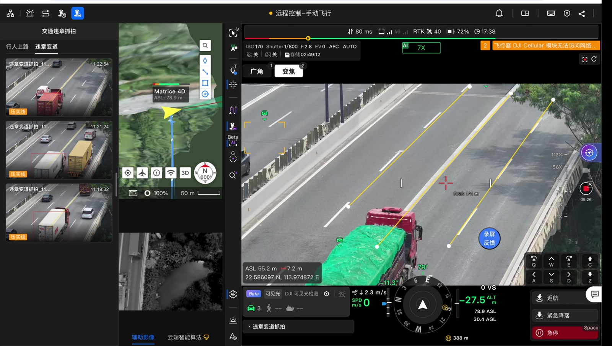
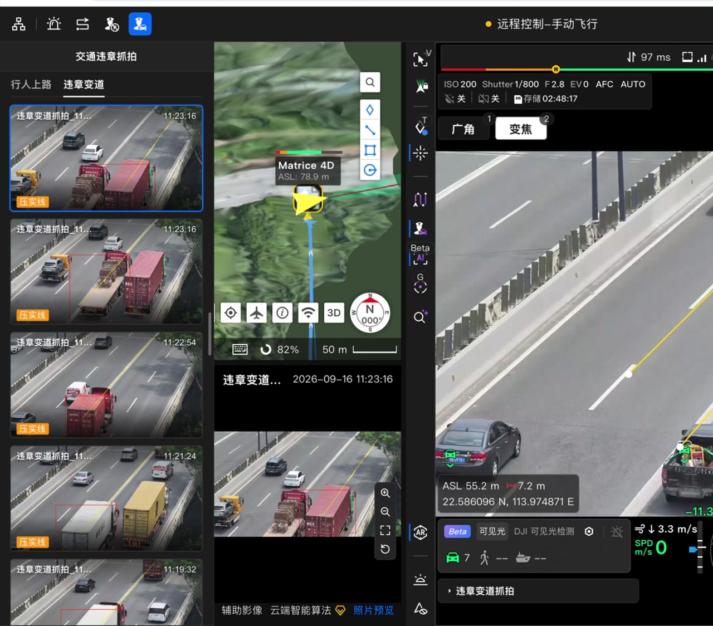

# 交通抓拍

本页是交通抓拍的业务案例：在驾驶舱里对变道和行人上路两种交通违法行为做自动抓拍，图片/视频事件交给后端建记录、去重、触发视频后处理流程。它说明驾驶舱能力（遥测、相机、检测、云台、热键……）与后端契约如何协作；本页提供架构与契约节选，并非完整可启动工程。可运行练习见[最小后端插件](./20.minimal-backend-plugin.md)和[最小全栈插件](./30.minimal-fullstack-plugin.md)。

## 这个示例做什么

- **两种互斥模式**：变道抓拍（越线检测）和行人上路抓拍，由单一切换队列保证同时只开一种。
- **驾驶舱能力**：开启模式前检查遥测、负载控制权、飞行模式、机场 SN、项目和航次；检测到目标后控制相机截图/录像。
- **后端契约**：检测到事件后调 `lane-change.*` 接口建记录，靠 `event_key` 唯一键去重；媒体生成事件触发后处理流程推进状态。
- **模拟数据与模拟器**：`enableMock` 配置可替换数据源用于纯前端演示；算法模拟器可离线调检测参数。

## 驾驶舱里的运行链路

这个案例的界面只有三处——左侧面板、画面浮层和子直播页签。真正的工作在入口（Entry）里：门控设备状态、把标线锚到地面、逐帧判定、命中后取证。


*左侧「交通违章抓拍」是 `cockpit.ui.left-panel`，缩略图列表是抓拍记录。直播画面上的黄色实线和白色顶点是插件通过 `cockpit.ui.live-overlay` 自绘的 Canvas 内容；绿色框和车辆 ID 是驾驶舱原生 AI 检测显示，插件通过 `cockpit:detection` 消费同一路逐帧结果。*


*选中记录后在 `cockpit.ui.sublive-tab` 查看证据图。黄色实线和红色 `bbox` 是插件在 `camera.captureFrame()` 得到的当前直播帧上叠加的，和事件上报使用同一组归一化画面坐标。*

### 七步链路

| 步骤 | 插件做什么 | 用到的能力 / 接口 |
| --- | --- | --- |
| 1. 运行门控 | 检查项目、机场 SN、活动航次，以及载荷控制权、飞行模式和设备状态；不满足就把开关置灰并说明原因 | `cockpit:context`、`cockpit:telemetry` |
| 2. 识别准备 | 开启可见光车辆识别，确认目标类型真的生效后再继续 | `cockpit:ai-config` |
| 3. 画面标注 | 在直播画面上铺满一层可交互 Canvas，绘制实线或导流区；绘制/编辑时接管指针，View 本地完成命中测试、拖拽顶点和右键菜单 | `cockpit.ui.live-overlay`、`cockpit:live-pointer` |
| 4. 地理锚定 | 新标注用激光测距高度反投成经纬度；相机移动时持续把地面标注投回画面，避免标线随镜头漂移 | `cockpit:scene-geometry` |
| 5. 逐帧检测 | 订阅 AI 检测帧，用 `frameId` 把地面标注投到当前帧，再把目标 `bbox` 和标线/导流区交给插件自己的规则 | `cockpit:detection` |
| 6. 命中取证 | 命中后截取当前直播帧（不是设备拍照），把标线和涉事车辆 `bbox` 叠到图上，写入 Blob 并上报事件 | `cockpit:camera`、`ctx.blobs`、`ctx.apiCall` |
| 7. 回到 UI | 记录写入左侧面板，证据图放进子直播页签，失败和状态变化走通知 | `cockpit.ui.left-panel`、`cockpit.ui.sublive-tab`、`platform:notification` |

### 标注怎么落到每一帧上

插件不直接解析原始 SEI 码流。宿主把机载 AI 的 SEI 解析成 `DetectionFrame`：`capturedAt` 是 AI SEI 时间，不是浏览器时钟；`bbox` 是有效画幅内的归一化坐标；`frameId` 可以用于同一帧的几何投影。插件通过 `cockpit:detection.onFrame()` 消费这份逐帧结果，并自己实现压线/进入规则。实线看车辆接地区域是否持续压线，导流区看 `bbox` 与多边形的重叠或进入状态；这些规则不在宿主里，也不在后端。检测和判定都在驾驶舱前端完成，后端只在命中后建记录、去重和做视频后处理，因此是否抓拍不依赖一次后端往返。

```ts
// 轮廓：省略能力不可用、空值和资源清理分支；真实实现必须逐个处理
const detection = await ctx.capabilities.get('cockpit:detection')
const geometry = await ctx.capabilities.get('cockpit:scene-geometry')
const camera = await ctx.capabilities.get('cockpit:camera')
if (!detection || !geometry || !camera) return

// 标注先反投到地面；相机移动时插件持续把地面点重投影回画面
const grounded = await geometry.projectVideoToGround(draftPoints, { groundHeight })
const groundPoints = (grounded?.points ?? []).filter(point => point !== null)

const off = await detection.onFrame(async frame => {
  // 用当前 SEI 帧自己的几何，把地面标线投回这一帧
  const line = await detection.projectFromGround(frame.frameId, groundPoints)
  const hit = evaluateLaneCrossing(frame.targets, line)   // 插件自己的业务规则
  if (!hit) return

  const shot = await camera.captureFrame({ scale: 0.5, mime: 'image/png' })
  // 在 shot.blob 上叠加命中的标线和 hit.bbox，再写入 ctx.blobs 并上报
}, { maxFps: 10 })
```

⚠️ 这里的 `maxFps` 要按插件运行时的上限请求；隔离环境中的上限是 10fps，超过上限会抛 `CAPABILITY_RATE_UNSUPPORTED`，不会静默降频。

### 插件实际拿到什么

扩展点只决定界面放哪；插件真正拿到的是：

- **状态**：项目、机场、航次、直播就绪、载荷控制权、飞行模式和设备状态。
- **画面**：`live-overlay` 提供可交互的画面层，`camera.captureFrame()` 能取得当前直播帧。
- **逐帧检测**：AI SEI 被解析成带时间、归一化 `bbox` 和 `frameId` 的检测帧。
- **几何**：画面坐标与地面坐标互投，可以把标线锚在道路上，而不是锚在某一帧的像素上。
- **业务写入**：命中后截帧、叠绘、写 Blob、建事件、去重和刷新记录。

变道抓拍的复杂度集中在状态门控、坐标投影、检测规则和证据一致性上；后面几步由[驾驶舱能力](../30.features/10.frontend/50.cockpit/00.index.md)承担。

## 关键代码讲解

### 清单贡献总览

```text
后端插件 ID：official_traffic_capture_backend（前端插件 ID 为 official_traffic_capture）
入口按钮：traffic-capture-popover-entry → cockpit.ui.toolbar-actions（入口按钮）
记录面板：capture-records → cockpit.ui.left-panel（抓拍记录面板）
预览页：capture-preview → cockpit.ui.sublive-tab（子直播预览页）
标注工作台：lane-change-workbench → cockpit.ui.left-bottom-panels（实线/导流区与抓拍控制）
覆盖层：lane-change-annotation-canvas / person-road-skip-hint / capture-alert-toast（直播覆盖层）
```

用到的关键能力（需在清单 `permissions` 里声明）：`cockpit:context`、`cockpit:telemetry`、`cockpit:camera`、`cockpit:detection`、`cockpit:scene-geometry`、`cockpit:ai-config`、`cockpit:live-pointer`、`cockpit:smart-track`、`cockpit:gimbal`、`cockpit:hotkeys`。

### 前端调用封装

```ts
// src/shared/api/invoke.ts
const PLUGIN_ID = 'official_traffic_capture_backend'
const INVOKE_ENDPOINT = '/plugin/invoke'

export function createPluginInvoke (apiCall: PluginContext['apiCall']) {
  return async (handler: string, input: Record<string, unknown>) => {
    const res = await apiCall<{ code: number; message: string; data?: unknown }>(INVOKE_ENDPOINT, {
      method: 'POST',
      body: { pluginId: PLUGIN_ID, handler, input },
    })
    if (res.code !== 0) {
      throw new Error(`[${res.code}] ${res.message}`)
    }
    return res.data
  }
}
```

⚠️ 这个封装没带 `idempotencyKey`。当前后端靠 `event_key` 唯一约束和原子 `createIfAbsent` 吸收重复创建，但**不要假设所有接口都天然幂等**——直接调后端做联调时，写操作应显式带 `Idempotency-Key`。

### 变道事件契约

检测到越线后，前端创建事件记录：

```json
{
  "pluginId": "official_traffic_capture_backend",
  "handler": "lane-change.create-event",
  "input": {
    "project_id": "project-001",
    "dock_sn": "dock-001",
    "flight_id": "flight-001",
    "event_key": "1788861600123:obj-01:region-01",
    "crossed_at": 1788861600123,
    "collision_type": "solid_line",
    "obj_id": "obj-01",
    "region_id": "region-01",
    "annotation_snapshot": {
      "name": "路口A实线",
      "kind": "line",
      "normalized_points": [
        { "x": 0.12, "y": 0.31 },
        { "x": 0.81, "y": 0.36 }
      ]
    }
  }
}
```

- `event_key` 固定为 `<crossed_at>:<obj_id>:<region_id>`。前端靠它把本地截图和后端记录精确合并，**不按时间窗口猜**。
- `collision_type` 只接受 `solid_line` / `guide_area`；归一化坐标必须在 `[0,1]`。
- 后端状态机：

```text
pending_video → waiting_artifacts → processing → verified | rejected | failed
```

`rejected` 是确定的业务结论（审核不通过）；`failed` 是处理失败。证据不全不能标成 `verified`。

### 后端：创建即去重

```ts
// handlers/lane-change/create-event.ts（节选：去重是核心）
export function createEvent (input: RecordInput, ctx: HandlerCtx) {
  // ...按契约校验各字段（枚举、时间戳、归一化坐标）...

  // event_key 作为业务唯一键，重复检测不会产生第二条记录
  const saved = store.createIfAbsent('lane_change_event', {
    event_key: input.event_key,
    project_id: input.project_id,
    post_status: 'pending_video'
  }, ['event_key'])
  if (!saved.ok) {
    throw saved.error
  }
  return {
    event_id: saved.data.record.id,
    event_key: saved.data.record.event_key,
    post_status: saved.data.record.post_status,
    created_at: saved.data.record.createdAt,
    created: saved.data.created
  }
}
```

创建和更新时间由平台维护，不写进 `createIfAbsent` 的业务记录。SQL 物理列是 `created_at` / `updated_at`，JS `store` 返回及筛选/排序使用公开名 `createdAt` / `updatedAt`；本例业务响应按[共享响应数据结构](../20.development/30.fullstack/10.shared-contracts.md)仍保留 `created_at`，从 `saved.data.record.createdAt` 映射，不改变传输契约。不能读取 `saved.data.record.created_at`，或把物理列名写进记录参数；SQL 建表语句不改为驼峰。

生产建表时在 `schema.sql` 里加唯一索引兜底（平台不会自动执行 `schema.sql`）：

```sql
CREATE UNIQUE INDEX IF NOT EXISTS uq_lane_change_event_key
  ON plugin_db_lane_change_event (event_key);
```

### 后端：媒体事件驱动后处理

视频生成事件到达后，把视频绑定到事件并启动后处理流程。以下是补偿逻辑的简化输入示例：`target_event_id` 表示本例已完成业务关联的目标记录 ID，不是承诺真实媒体消息自带该字段；真实消息形状与关联规则必须单独对账。本例需申报 `data:read`、`data:write`、`flow:start`：

```ts
// events/video-created.ts
export function onVideoCreated (input: RecordInput, ctx: EventCtx) {
  const eventId = String(input.target_event_id || '').trim()
  const fileId = String(input.file_id || '').trim()
  if (!eventId || !fileId) {
    throw { code: 'INVALID_ARGUMENT', message: 'target_event_id 和 file_id 不能为空' }
  }

  // 条件更新：只有 pending_video 能推进，消息重投不会重复处理
  const moved = store.update('lane_change_event', {
    id: { eq: eventId },
    post_status: { eq: 'pending_video' }
  }, {
    video_file_id: fileId,
    post_status: 'waiting_artifacts'
  })
  if (!moved.ok) {
    throw moved.error
  }
  if (moved.data.affected === 0) {
    const current = store.query('lane_change_event', { id: { eq: eventId } }, { limit: 1 })
    if (!current.ok) throw current.error
    const saved = current.data.list[0]
    if (!saved || saved.post_status !== 'waiting_artifacts' || saved.video_file_id !== fileId) {
      return { bound: false }
    }
  }

  const started = flow.start('lane-change-postprocess', eventId, {
    event_id: eventId,
    video_file_id: fileId
  })
  return { bound: moved.data.affected === 1, already: started.already }
}
```

`affected === 0` 不证明作业已启动：可能上次更新成功但启动失败。本例只在记录仍为 `waiting_artifacts` 且绑定同一文件时补启，缺记录、已改绑或已推进状态则返回对象；每次补启都复用同一个流程名、`bizId` 和 `seed`。

对应的事件清单声明与 `job` 触发段：

```json
{
  "events": [
    {
      "type": "media.video_created",
      "consumer": [ { "handler": "events/video-created.ts", "entry": "onVideoCreated" } ]
    }
  ]
}
```

```json
{ "trigger": { "job": { "seed": ["event_id", "video_file_id"] } } }
```

这是两键补偿片段示例，`job` 触发段不是完整流程定义。[作业、目标轨迹与视频处理](../30.features/60.backend-capabilities/80.job-trajectory-video.md)的三键片段示例不能直接接收这里的调用。查询或启动持续失败仍会耗尽有界重试并丢弃消息（`Discard`），依赖恢复后需人工重放；不承诺自动死信恢复。

事件类型由平台指定（目前是 `media.photo_created` 和 `media.video_created`）。HTTP、事件和流程脚本三路共用按有效 `allowlist` 注入的方法，包括轨迹和视频；重活建议交给流程作业，这是工程建议，不是路线硬隔离。注入不代表部署的能力提供方可用，仍需另行验证。

后端运行时中命中的消费方并发执行、各自独立重试，全部结束后按 **Requeue > Discard > Ack**（重新入队 > 丢弃 > 确认）聚合消息处置；有业务先后依赖应放在同一个消费函数内调用或显式流程编排。入口必须返回对象，通常为 `{}`；事件入口顶层失败信封会按 `error.code` 分类，HTTP 接口处理函数和流程脚本不自动提升返回的失败信封，需要失败时须显式 `throw result.error`，见[事件消费参考](../70.api-reference/20.backend/30.event-api.md)。

### 模拟数据的准确边界

```ts
const mockRuntime = enableMock
  ? createMockTrafficRuntime({ timers: ctx.timers })
  : null
const laneChangeApi = mockRuntime?.laneChangeApi ?? createLaneChangeApi(invoke)
const personRoadApi = mockRuntime?.personRoadApi ?? createIllegalRoadApi(invoke)
const ws = mockRuntime?.ws ?? ctx.ws
```

`enableMock` 只替换 HTTP / WebSocket / 媒体数据源：

- 真实宿主里设备能力仍由真实能力提供方提供；本地调试页面里设备能力提供方本身就是本地模拟器。两种情况都要在测试报告里写明。
- 模拟变道会保存事件但**不伪造**后处理证据；模拟行人上路会定时生成演示图片并发媒体通知——它证明前端刷新流程，不证明相机拍摄和识别质量。
- 本地模拟器不用于证明后端运行时的消费方并发、独立重试或消息确认/死信处置；这些边界需在已部署测试环境验证，消息重放和依赖恢复由部署方协助。

| 项目 | 本地限制 | 验证方式 |
| --- | --- | --- |
| 错误信封 | 当前本地网关返回数字分类，HTTP 状态等仍不能代替目标环境验证 | 在测试网关验证 `40006` / `20001` / `50301` 及前端错误映射 |
| 媒体消息 | 本地模拟器的 `data` 包装与真实媒体消息顶层字段有差异 | 按真实消息定义验证关联，不增加双形状兜底 |
| 查询排序 | 对象 `orderBy` 在本地模拟器中可能被忽略，有限列表不保证包含最新记录 | 保持正式查询形状，在部署环境验证时间窗、排序和分页 |
| 处理证据 | 演示图片、通知和模拟任务状态不是拍摄或视频分析证据 | 使用实际录制文件、轨迹和权威任务状态验收 |

## 案例定位与依赖

本案例不包含可公开获取的完整工程，因此不提供下载或工程启动命令。离线算法模拟器只是本案例的一种检测参数调试方式，不是生成工程自带的工具。创建和 HTTP 冒烟使用[最小后端插件](./20.minimal-backend-plugin.md)，前后端状态闭环使用[最小全栈插件](./30.minimal-fullstack-plugin.md)。

复用架构到自己的插件时，需要补齐检测、状态机、接口和媒体关联实现。本案例的 `enableMock` 默认关闭；只有自己的插件实现并声明了该配置时，才能在本地调试页面调整并重载。它仅切换数据源，不会创建真实网关、消息队列或视频分析服务。

| 依赖 | 验证前提 |
| --- | --- |
| 前端宿主与能力 | 相机、检测、遥测和控制权可用；真实设备测试需获批项目与设备 |
| 后端接口与存储 | 部署方确认插件版本已安装、业务表及唯一索引已建；本案例的完整实现涉及 13 个接口处理函数和 3 个事件消费方 |
| 媒体事件与流程 | 部署方确认事件投递、完整 `job` 定义、两键或三键 `seed` 对账，以及队列可用 |
| 视频后处理 | 对象存储、媒体登记和视频分析能力提供方就绪，并提供实际视频与轨迹数据 |

在自己的工程中，`validate` 检查接线，`build` 只生成产物，`pack` 构建并组装交付包，都不启动网关；含后端且非 `--frontend-only` 的 `dev` 只启动本地 HTTP 模拟器，不执行流程。运行时行为使用部署方提供的测试入口和凭据，按[后端调试](../40.debug-and-test/30.backend-debugging.md)的统一入口验证；完整媒体和队列行为需在该环境另验。

## 常见问题

| 现象 | 原因与处理 |
|---|---|
| 模式开关置灰 | 遥测、控制权、飞行模式、机场 SN、项目、航次或关键能力不完整，看检查提示 |
| 模拟数据开了还是没检测 | `enableMock` 不替代检测 / 遥测能力；本地调试页面场景或真实宿主要提供检测帧 |
| `enableMock=false` 时请求 404 | 确认自己的工程包含后端且 dev 未使用 `--frontend-only`，或目标测试环境已安装匹配后端；本地 HTTP 模拟器不提供真实流程执行 |
| 列表顺序或视频匹配失败 | 检查 13 位定宽毫秒时间戳、`orderBy` 字段、`gte/lte` 时间窗和数据库索引 |
| 事件一直停在 `pending_video` | `media.video_created` 事件源未配置，或消费方绑定失败（查日志/死信） |
| 后处理失败 | 检查对象存储、视频能力提供方和媒体登记是否可用；方法已注入不等于部署依赖已就绪 |
| 同一个 `pluginId` 装载冲突 | 两个同 ID 插件包不能同时装载；确认只部署了一份 |

## 延伸阅读

- [驾驶舱扩展点](../30.features/10.frontend/50.cockpit/10.extension-points.md)：工具栏、面板、覆盖层等位置。
- [相机与检测能力](../30.features/10.frontend/50.cockpit/30.camera-detection-and-ai.md)：本例重度使用的设备能力。
- [前后端共享契约](../20.development/30.fullstack/10.shared-contracts.md)：变道事件契约的完整说明。
- [事件、通知与状态](../20.development/30.fullstack/30.events-and-state.md)：媒体事件驱动后处理的模式。
