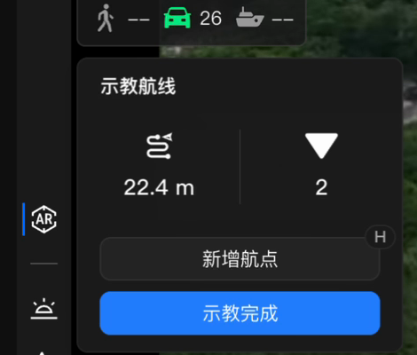
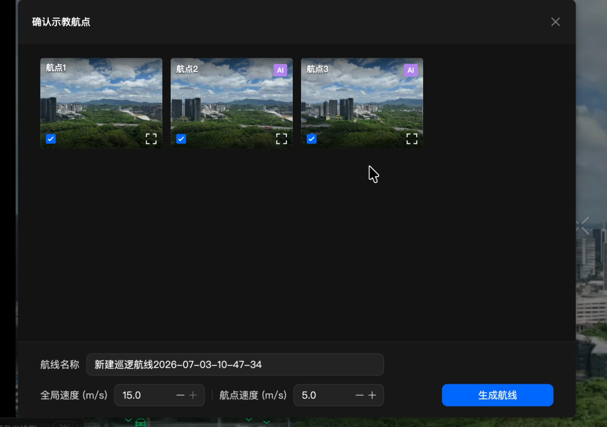
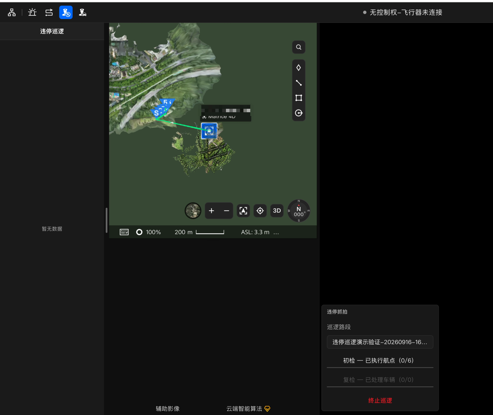
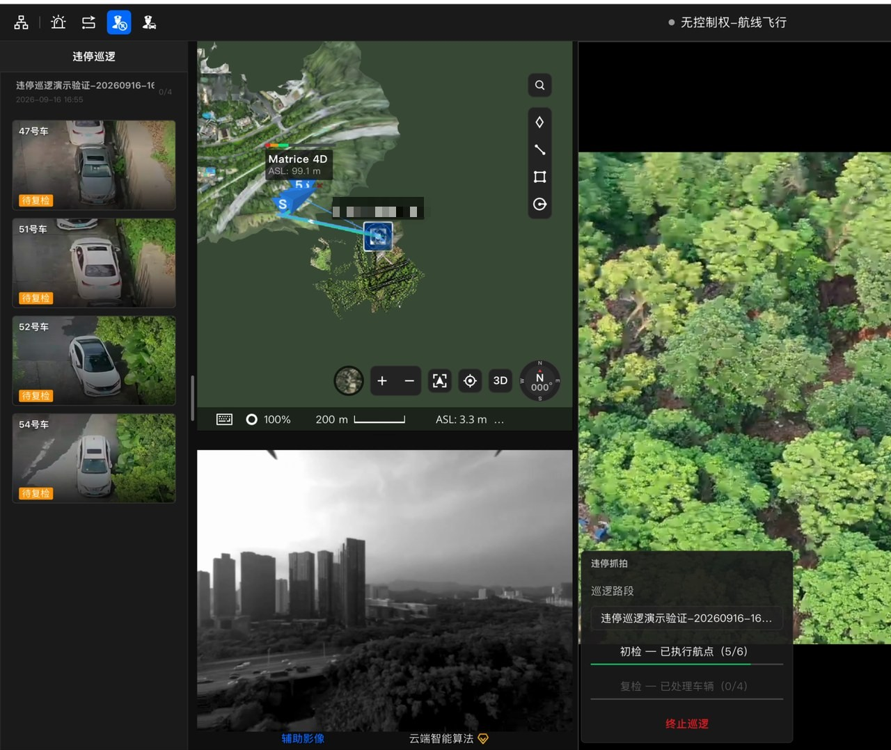
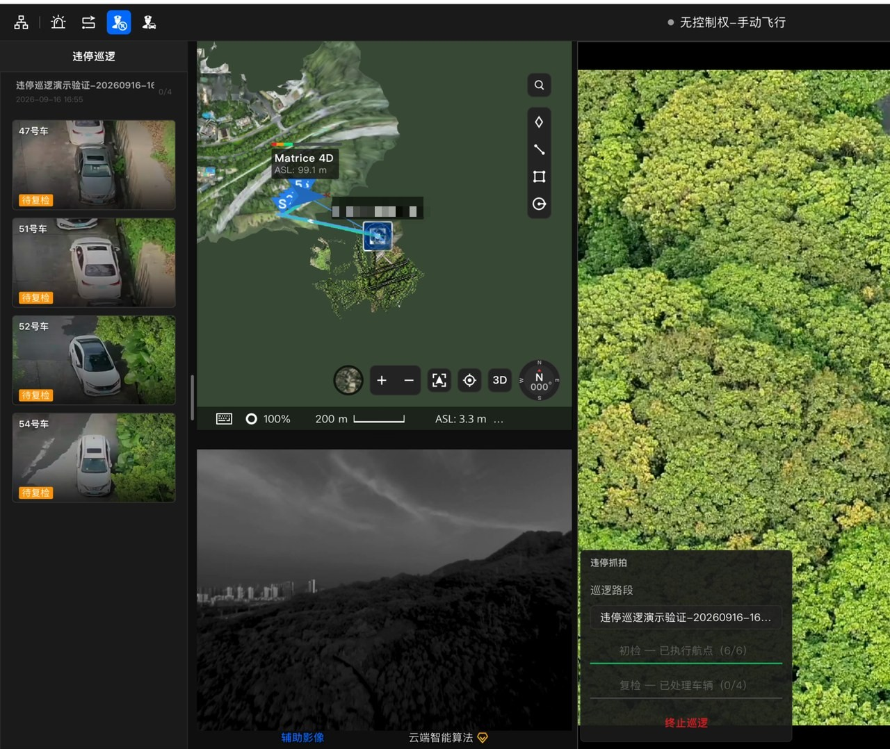
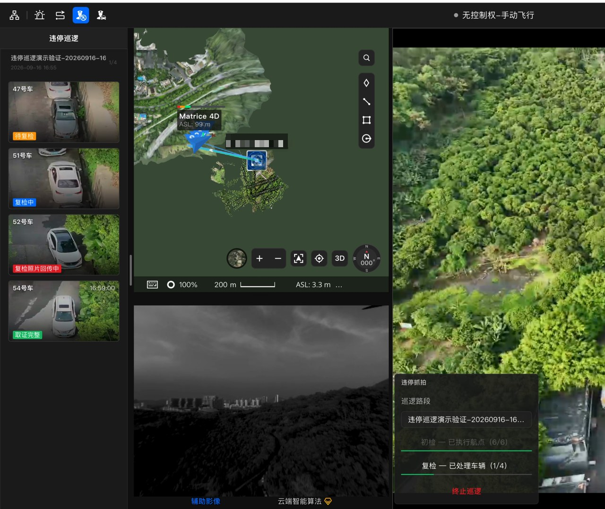
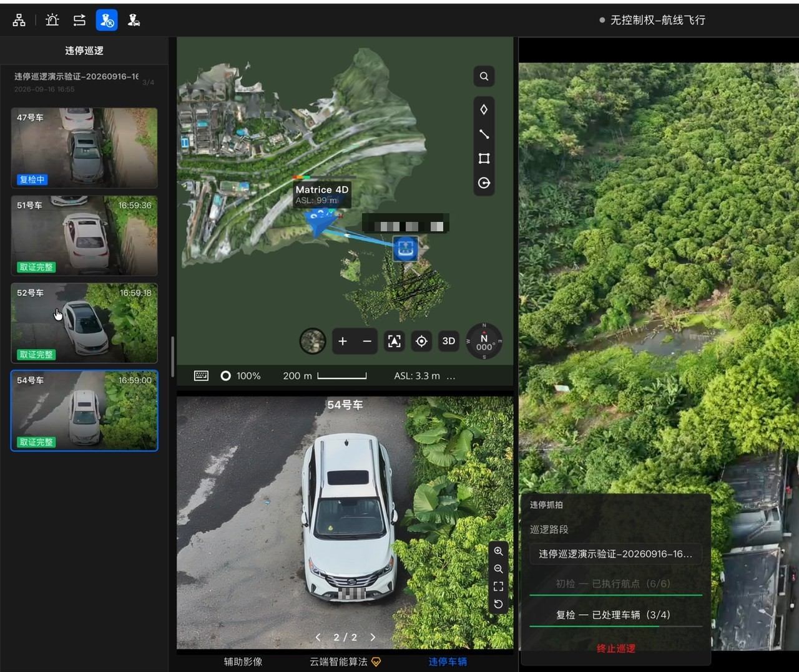
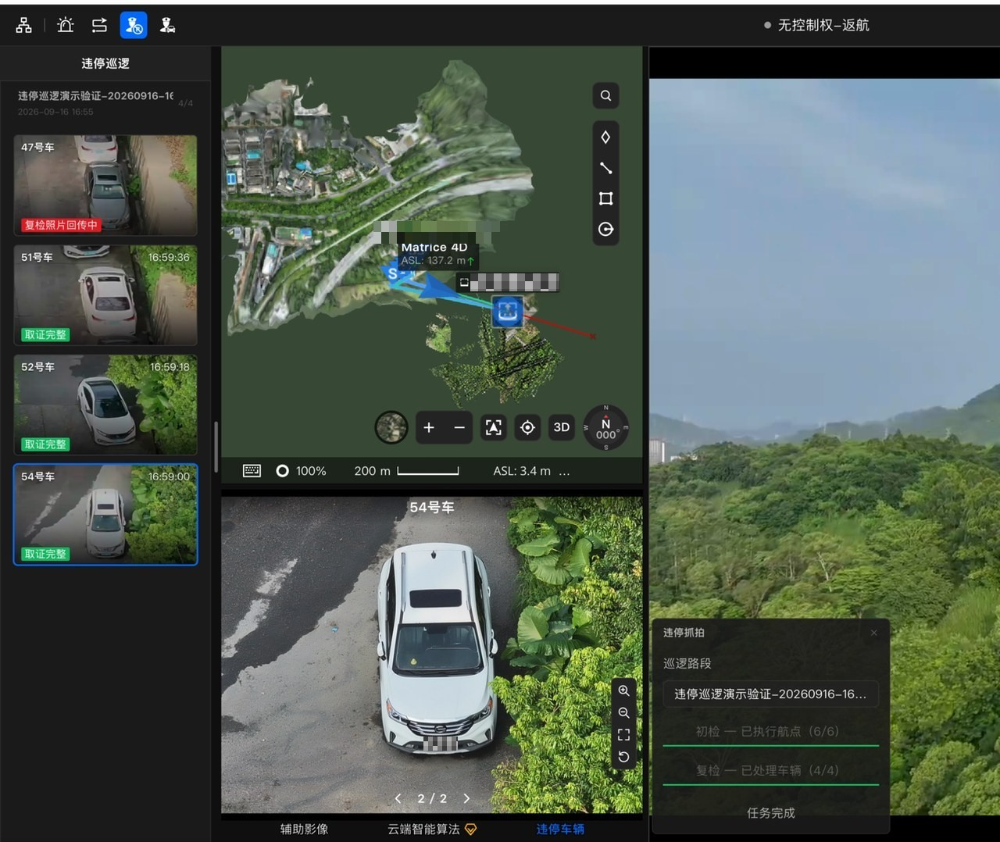
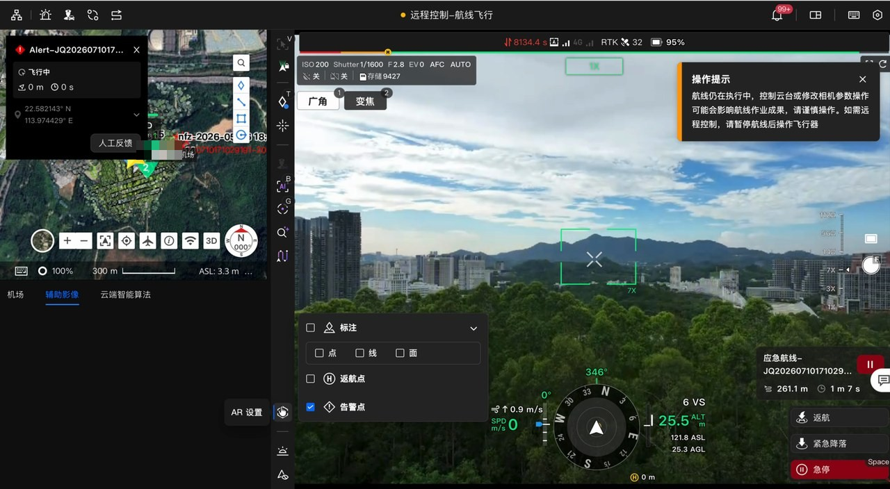

# 违停巡逻完整案例

在司空（FH2）里，插件把一项业务接到用户已经熟悉的页面上。本页用两个真实业务说明插件能出现在哪里、用户会看到什么、操作按什么顺序推进。

- **全自动违停抓拍**：先示教一条路段，在计划库配置巡逻；任务起飞后，驾驶舱显示初检、复检进度和车辆照片，最后由操作员确认返航或继续人工控制。
- **事故快处**：项目页面接收并签收警情，消息卡片选择设备和路线，后端下发任务，驾驶舱进入对应现场。

下面先看四类宿主，再看两条完整流程。

## 插件会出现在哪里

司空前端提供四类宿主（Host），分别承载驾驶舱操作、计划配置、项目业务和消息处理。

| 宿主 | 用户在哪里看到插件 | 插件增加什么 |
| --- | --- | --- |
| `cockpit` 驾驶舱 | 直播底部工具栏、直播左下角、侧面板、子画面页签 | 工具栏入口、进度面板、目标列表、照片页签 |
| `plan` 计划库 | 新建/复制普通任务表单 | 表单中的业务填写区域，随任务一起校验和提交 |
| `project` 项目页面 | 左侧导航入口 | 插件自己的列表或工作区 |
| `message` 消息中心 | 告警弹层 | 自定义业务卡片和卡片内操作 |

### 驾驶舱：直播旁的操作、进度和照片

“示教航线”入口位于直播底部工具栏的 AI 识别入口之前，点击后打开左下角录点面板。“违停巡逻”在直播左下角显示任务进度，在侧面板列出车辆，点击车辆后打开“违停车辆”照片页签。操作员可以保持直播可见，同时查看任务和照片。

*违停巡逻进行中：左侧为车辆卡片，左下角为初检/复检进度。*

### 计划库：原表单中的巡逻配置

计划宿主在飞行计划表单中增加业务填写区域，并随表单一起校验和提交。用户在原表单中选择航线、设备和执行时间，然后在任务策略配置区之后打开“违停巡逻”，填写复检间隔。航线选择、设备选择和插件配置放在同一张表单中，提交后形成一条带巡逻配置的飞行任务。

*任务策略之后的“违停巡逻”区域：演示任务把复检间隔填为 1 分钟以便缩短等待，默认值为 10 分钟。*

### 项目页面：从侧边栏进入业务列表

项目宿主可以在左侧导航增加插件入口，点击后打开插件自己的列表或工作区。“事故快处”入口打开警情列表，卡片显示地址、报警时间和当前处理状态。用户选中警情后，可以在相邻地图查看位置，再签收、补录坐标或继续派遣。

*报警事件列表：已签收的记录提供“立即派遣”，未签收的记录显示“签收任务”。*

### 消息：直接在卡片中选择设备和路线

消息宿主可以在消息中心的告警弹层显示自定义卡片。事故快处的派遣卡显示警情内容、设备列表和推荐路线：设备卡片展示电量及可用状态，路线卡片展示距离和预计时间，用户选好后点击“立即派遣”。业务操作可以直接在消息卡片中完成。

*派遣卡停在确认前：已选一台空闲设备和一条推荐路线，等待“立即派遣”。*

## 场景一：全自动违停抓拍

这条业务围绕一条明确的巡逻路段展开：先由人记录路线，之后按任务配置自动扫描停车目标，等到设定间隔再逐个复检，将初检资料和回传照片归到车辆记录中。操作员主要负责前期配置、过程监看和最终处置。

**人工示教路线 → 配置巡逻计划 → 计划下发起飞 → 初检发现目标 → 等待复检间隔 → 逐个复检并回传照片 → 查看记录、返航或人工控制。**

### 1. 人工飞一次，把路段记录成航线

操作员在获准飞行中进入驾驶舱，打开“示教航线”，沿需要巡逻的路段记录航点。到达要记录的位置后点击“新增航点”，也可以按 `H`；插件读取飞机位置、相机焦距、云台姿态和 AI 识别状态，并截取直播画面，供生成前检查。录点面板会更新路线距离和航点数。

*示教航线面板：显示已录距离、当前航点数，提供“新增航点”和“示教完成”。*

生成前，在对话框中检查截图并选择要保留的航点，至少选择两个航点，填写航线名称、全局速度和航点速度，再点击“生成航线”。生成后，这条路线就可以在后续计划中选用。录点和生成由示教插件完成，下一步的任务配置由巡逻插件接续。

*确认示教航点：选择要保留的航点，填写航线名称、全局速度和航点速度后“生成航线”。*

### 2. 在计划库选择路线，设置这次怎样巡逻

新建或复制普通飞行任务，选择刚生成的单条示教航线和对应设备，设置执行策略，再打开“违停巡逻”。开启后会出现“违停复检间隔(分钟)”输入框，默认 **10 分钟**，可填写 **1-25 分钟的整数**。使用默认值时，任务会在初检结束后等待 10 分钟，再进入复检；复制巡逻任务时会继承有效的开关和间隔。

*“违停巡逻”开关与“违停复检间隔(分钟)”。*

这一步把“飞哪条路线”和“初检后隔多久再看”固定到同一任务。用户提交的是原计划表单，插件在校验通过后将巡逻参数随任务一起提交，并为后续等待与复检准备航线结束动作。

### 3. 计划下发并起飞，驾驶舱接入巡逻任务

提交后，飞行任务按计划库选定的执行策略下发。巡逻流程等待任务进入执行阶段，再接入这次巡逻；起飞由计划任务负责。进入对应驾驶舱后，插件识别当前巡逻任务，展开“违停巡逻”记录面板，在直播左下角显示巡逻路段及任务状态。面板先显示接入状态（例如“正在准备巡逻…”），随后进入初检。

*任务已接入：左下角显示“初检 0/6、复检 0/0”。*

随后，“初检”一行开始显示已执行航点数，操作员可以将巡逻面板进度与原飞行任务状态一起查看。

### 4. 沿示教路线初检，把目标放进记录列表

初检沿示教路线扫描，发现的停车目标进入待复检列表，并尝试保存初检截图。直播左下角的面板显示“初检”已执行航点数，侧面板逐步出现车辆卡片。每张卡片包含目标名称、缩略图和“待复检”状态；名称可以是“12号车”这样的目标编号。

*初检 5/6：左侧车辆进入“待复检”列表。*

记录先出现在列表中，操作员就能查看发现位置和初检资料。之后，同一条记录继续接收复检状态与照片，方便前后查看。

### 5. 初检结束，等待配置的复检间隔

初检完成后，任务进入等待阶段，飞机按流程悬停等待，再转入复检。间隔从**初检完成后**开始计算；正文按默认 **10 分钟**说明；截图中的演示任务实际配置为 1 分钟，用于缩短等待。面板保留已完成的初检航点进度，车辆列表仍可查看，操作员继续监看直播和设备状态。

*初检 6/6、复检 0/4：等待复检间隔。*

等待期间仍可从任务面板发起“终止巡逻”，结束剩余复检并进入相应收尾流程。正常继续时，面板的活动进度转到“复检”，开始按目标逐个处理。

### 6. 逐个复检，照片回传到对应车辆

复检围绕初检留下的目标逐个进行，检查目标位置并采集照片。面板显示“复检”已处理车辆计数，车辆卡片随过程显示“复检中”“复检照片回传中”，之后显示“取证完整”“复检失败”或“目标消失”等实际结果。照片回传后，可以在该目标的预览中继续翻看。

*复检进行中：待复检、复检中、复检照片回传中、取证完整同时出现。*

这一步把任务进度和目标结果分开呈现：任务面板回答“处理到哪里”，车辆卡片回答“这一个目标现在怎样”。操作员查看具体卡片，就能区分仍在处理、等待照片和已出结果的目标。

### 7. 回顾照片，决定返航或继续人工控制

点击车辆卡片后，“违停车辆”照片页签会打开，地图标出目标位置，原记录面板继续保留。预览按实际媒体显示初检图片和已回传的复检照片，可以通过页码和左右切换查看。任务结束后还可以回看本轮资料，下一轮任务到来时再切换到新的记录。

*打开“违停车辆”页签，按页码查看该目标的初检与复检照片。*

复检完成后有 **30 秒返航决策窗口**，弹窗显示实际剩余时间。点“返航”请求立即返航，点“不返航”取消本次自动返航并转入人工控制；未操作时，流程在窗口结束后进入返航。操作员根据设备状态继续确认后续控制和飞行结果。

*复检 4/4 后任务完成，进入返航决策窗口。*

这条流程留下的是一次巡逻的路线、进度、目标结果和关联照片。前期只需示教路段并配置任务，过程中可以持续查看每个目标，最后集中回顾资料和处理飞行收尾。

## 场景二：事故快处

事故快处把警情处理、设备与路线选择、任务下发连在一起。

1. **签收警情**：在项目页面的警情列表选中一条记录。已有位置时可以在地图查看，缺少位置时通过卡片补录坐标；签收后的卡片提供“立即派遣”。
2. **选择设备与路线**：点击“立即派遣”后，在消息中心打开派遣卡，先选一台可用设备，再从推荐路线中选择本次要执行的路线。确认时会重新检查设备状态，并把选定设备与航线交给后端流程。
3. **进入驾驶舱**：任务下发后打开对应驾驶舱。操作员可以在驾驶舱观察执行，并回到警情记录查看业务状态和关联飞行记录。

*派遣后在驾驶舱查看告警卡与飞行状态。*

同一警情从列表到派遣卡再到驾驶舱，用户沿着当前任务继续处理，减少在不同页面重复填写警情、设备和路线信息。

## 准确使用边界

> 以下边界适用于上面的业务案例和截图。

| 边界 | 具体含义 |
| --- | --- |
| **案例范围** | 本页说明已有代码中的业务流程，不表示已在某个项目部署。“全自动”指人工示教和任务配置后的巡逻、复检流程；真实运行需要匹配的后端流程、巡逻执行能力、媒体回传及设备条件，并完成现场验收。 |
| **计划与等待** | 违停配置用于普通单航线任务，暂不支持多航线、多模态识别和连续执行；切到多航线会关闭巡逻开关。复检间隔接受 1-25 分钟整数，缺少参数或后端读取失败时可能直接复检，接入时要验证实际等待。当前没有“立即开始复检”按钮和等待专用倒计时。 |
| **目标与证据** | 目标编号不是识别出的车牌。初检至多一张截图，复检为零到多张照片；首张复检照片入库可推进完成，“取证完整”标签不保证固定数量、固定角度、车牌识别、同车核验或执法证据合格。已处理数量包含失败和目标消失。 |
| **时间与回顾** | 初检图片时间来自目标记录创建时间，复检照片使用相机拍摄时间，不能直接相减得到精确停车时长。记录面板展示本轮任务并保留至下一轮，完整历史查询与执法审核需要另外实现。 |
| **飞行与操作结果** | 请求受理、派遣成功提示或复检完成都不代表已经到场、返航或落地；要继续确认实际任务和设备状态。“不返航”后飞机仍在空中，操作员需确认控制状态并继续操控。关闭插件面板不等于终止飞行任务。 |
| **截图与本地演示** | 截图使用获准测试任务，真实宿主中的测试数据也保留测试标识；模拟图片、按钮推进和演示状态只用于说明界面，不充当真实检测、拍摄或飞行结果。入门模板的计数和现场问题记录在前端内存中，刷新会重置；本地后端模拟器也是进程内存，重启或重置会丢失修改。 |

> **素材说明**：本页截图来自获准的测试飞行与演示录屏，仅用于说明界面，不代表已部署或现场验收。

想亲手打开一个插件面板，进入[快速入门](../../10.quick-start/00.index.md)。已有工程时，在[开发指南](../00.index.md)按任务查写法；分不清业务能力、页面位置和 API 时，先读[什么是插件开发](../10.concepts/10.what-is-plugin-development.md)。
