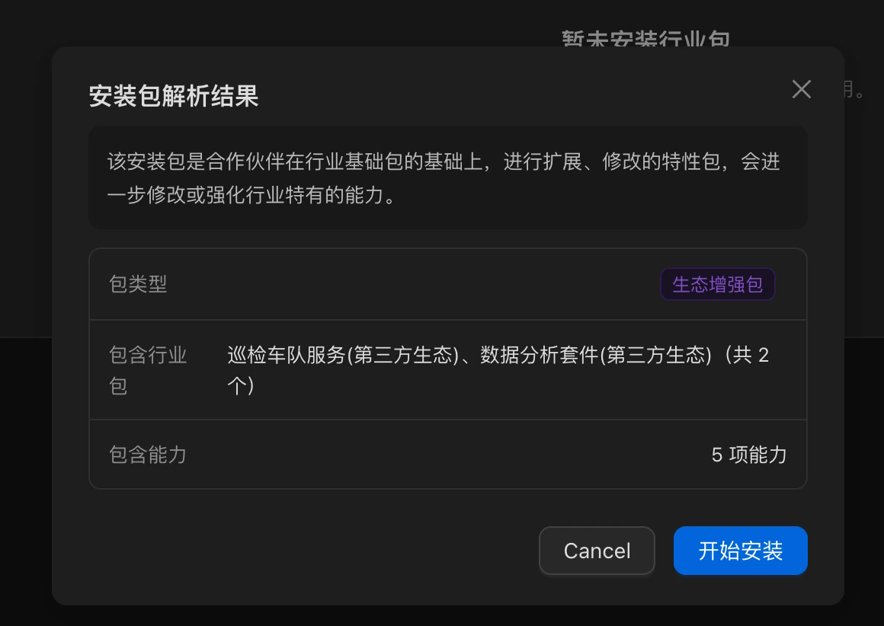
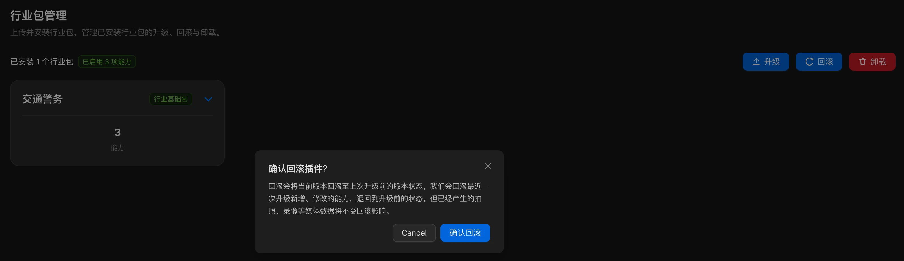

# 安装、升级与回滚

执行 `pnpm run pack` 后，使用终端 `UPLOAD_READY` 打印的 ZIP 上传安装。打包步骤见[行业包构建与打包](./20.industry-package.md)。

## 上传与安装

准备管理平台账号、行业包安装权限和安装文件，确认当前插件化底座版本满足包要求。

### 首次安装官方行业包

1. 进入「**插件化管理 → 行业包管理**」，点击「**上传插件包**」。
2. 选择官方行业包文件，等待格式、完整性、签名、版本和兼容性校验。
3. 校验通过后，确认包类型为「**官方行业包**」，点击「**进入安装向导**」。
4. 按向导完成配置：

   | 步骤 | 操作 |
   | --- | --- |
   | 选择行业包 | 勾选需要的行业能力 |
   | 配置偏好 | 配置所选能力；重复能力合并去重 |
   | 确认清单 | 核对能力清单和待配置项，处理阻断提示 |
   | 加载行业包 | 等待全部加载与健康检查成功 |

5. 安装完成后，在已安装列表查看包类型、包版本和底座满足状态。

加载成功前的配置是草稿；退出向导会丢弃草稿，不影响当前运行配置。

### 安装生态行业包

快速入门生成的安装包按生态行业包流程安装，目标平台须允许安装生态包。

1. 点击「**上传插件包**」，选择本次 ZIP，等待校验。
2. 校验通过后，确认页面显示「**生态行业包**」，查看安装清单和资源影响。

   

   *截图取自用户手册，图中包类型文案可能沿用旧名称，以正文为准。*

3. 包内内容默认全选且不可反选，不进入逐项配置向导。
4. 点击「**立即开始安装**」，等待加载与健康检查完成。

安装完成后刷新司空页面，打开插件查看功能。校验失败或包内容不能完整安装时，按页面提示处理后重试。

## 升级

准备比当前版本更高的行业包文件。

1. 在已安装行业包页点击「**升级**」，上传目标版本包。
2. 等待格式、版本、包类型和兼容性校验。
3. 校验通过后按包类型继续：
   - **官方行业包**：点击「**进入升级向导**」。已安装能力默认选中且不可取消；新增能力可自行选择。
   - **生态行业包**：核对全量清单，点击「**立即开始安装**」。
4. 确认清单并开始升级。系统先备份当前运行版本，再加载新版本。
5. 加载与健康检查成功后，在已安装列表查看新版本，再刷新司空页面。

校验被拒绝或升级失败时，当前版本和已安装能力保持不变，按失败提示处理。

## 回滚

升级后需要恢复旧版本时：

1. 在已安装行业包页打开「**回滚**」，查看当前版本和可用历史快照（最多 1 条）。
2. 选择目标快照，阅读提示并二次确认。

   

3. 等待回滚完成，点击「**继续**」返回已安装行业包页。
4. 核对恢复后的版本，刷新司空页面并检查插件功能。

**回滚会丢失上次升级后的变更，请谨慎操作。** 回滚本身不新增快照；没有可用快照时不能回滚。
