# 前端扩展点目录

扩展点是宿主预留的 UI 位置（工具栏按钮、左面板、表单区块……）。插件先在清单里声明「我要占用哪个位置」，再在运行时 `contribute()` 提交内容。目录封闭，以本页表格为准，不能自造。

用法：清单 `extensions[]` 写 `{id, point, ...static 字段}`，运行时 `ctx.extensions.contribute(id, {state..., method...})`。全部扩展点都允许多个插件同时贡献。

> **扩展点回答“放在哪”，不回答“能做什么”。** 插件入口是完整的前端运行时：除了提交 UI，它还能通过宿主能力读取驾驶舱状态、消费带 SEI 时间的 AI 检测帧、在直播画面上自绘 Canvas，并基于这些信息做业务判断。变道抓拍只声明了 7 个扩展点，却同时使用了遥测、检测、几何、相机、指针等 10 个驾驶舱能力（另有地图、通知、存储等平台能力）。不要把它理解成 Vue 的 `slot`——`slot` 只传 UI，插件拿到的是状态、画面、逐帧检测和取证链路。完整例子见[交通抓拍](../../50.examples/50.traffic-capture.md#驾驶舱里的运行链路)。


*同一插件同时使用多个扩展点：左侧「交通违章抓拍」是 `cockpit.ui.left-panel`；直播画面上的黄色实线与白色顶点是 `cockpit.ui.live-overlay` 里的 Canvas 自绘内容。绿色框和车辆 ID 是驾驶舱原生 AI 检测显示；插件通过 `cockpit:detection` 消费同一路逐帧结果做判断。*

## 通用规则

**字段归属**：**清单静态字段**写进清单，安装后不可变（决定位置、锚点等）；**扩展状态初值**是 `contribute()` 的初值，之后用 `handle.update()` 改；**回调方法**是 `contribute()` 传入的函数，由宿主在特定时机回调。带 `?` 可省略，`=` 后为默认值。

**多贡献排序**：同一位置按 Engine 生成的 PluginPlan 列表顺序展示；同一插件的多个扩展再按清单内声明顺序排列。顺序稳定可预期，与各插件 `activate()` 的异步完成先后**无关**。

**生命周期**：`contribute()` 只能在激活的登记阶段调用——激活流程走完后再调会抛 `HOST_RUNTIME_DISPOSED`。激活失败时本次全部贡献原子回滚，不会留下半套界面。

**图标**：`icon` 填图标 ID，图标资源要先在清单里声明，否则按钮渲染不出图标（见[插件清单](./10.manifest-schema.md)）。

**错误码速查**：未在清单声明（或不属于当前宿主）就 `contribute()` → `EXTENSION_DECLARATION_INVALID`；同一 id 重复贡献 → `REGISTRATION_CONFLICT`；`update()` 传了契约没有的字段或值非法 → `HANDLER_STATE_INVALID`。

## 目录

<!-- FH2-KB:BEGIN frontend-point-catalog -->
| 扩展点 ID | 宿主 | 清单静态字段 | 贡献初始状态 | 回调方法 |
| --- | --- | --- | --- | --- |
| `cockpit.ui.flight-actions` | 驾驶舱 | `anchor?`: `flight-actions` \| `flight-actions:after-return-home` | `active?`=`false`、`disabled?`=`false`、`icon`、`label`、`visible?`=`true` | `onTrigger` |
| `cockpit.ui.left-bottom-panels` | 驾驶舱 | 无 | `interactive?`=`true`、`visible?`=`false`、`width?`=`240` | `render` |
| `cockpit.ui.left-panel` | 驾驶舱 | 无 | `icon?`、`label`、`visible?`=`false`、`width?` | `render` |
| `cockpit.ui.live-context-menu` | 驾驶舱 | 无 | `disabled?`=`false`、`icon`、`label`、`visible?`=`true` | `onTrigger` |
| `cockpit.ui.live-overlay` | 驾驶舱 | `overlayLevel`: `normal` \| `top`、`stream?`: `DronePayload` \| `DronePayloadSide` \| `Fpv` \| `Dock` \| `Assistant` \| `LensType` | `bottom?`、`height?`=`36`、`interactive?`=`false`、`left?`、`offsetX?`、`offsetY?`、`placement`: `fill` \| `top` \| `bottom` \| `top-left` \| `top-right` \| `bottom-left` \| `bottom-right` \| `custom`、`right?`、`top?`、`visible?`=`false`、`width?`=`320` | `render` |
| `cockpit.ui.menubar` | 驾驶舱 | 无 | `active?`=`false`、`disabled?`=`false`、`icon`、`label` | `onTrigger` |
| `cockpit.ui.sublive-tab` | 驾驶舱 | 无 | `icon?`、`label`、`visible?`=`false`、`width?` | `render` |
| `cockpit.ui.toolbar-actions` | 驾驶舱 | `anchor?`: `footer-toolbar` \| `footer-toolbar:before-ai` | `active?`=`false`、`disabled?`=`false`、`icon`、`label` | `onTrigger` |
| `message.alert-popups` | 消息 | 无 | `visible?`=`false` | `render` |
| `plan.form-extensions` | 计划 | `anchor?`: `form-end` \| `task-strategy:after`、`planType`: `all` \| `normal` \| `atob` \| `manual` | 无 | `onEditSubmit?`、`onSubmit`、`render`、`validate` |
| `project.sidebar-actions` | 项目 | `path`、`position?` | `disabled?`=`false`、`icon`、`label`、`showBadge?`=`false` | `render`、`renderWorkspace?` |
<!-- FH2-KB:END frontend-point-catalog -->

## 各扩展点详解

上表是字段速查，这一节解释每个位置**是什么、怎么用**。字段值域以上表为准，这里不重复。

各图红框为插件区域；标*模拟界面*的取自本地调试页面，其余取自测试飞行与演示录屏，文案仅示意位置。

### 驾驶舱（cockpit）

#### `cockpit.ui.toolbar-actions` —— 底部工具栏按钮

驾驶舱底部工具栏里的动作按钮。

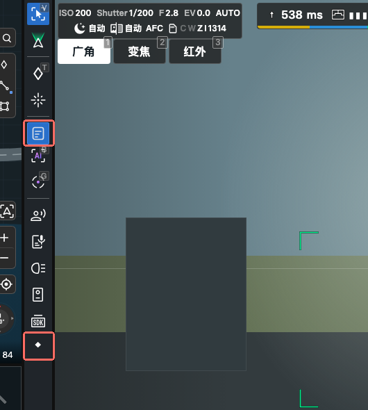

*红框为插件区域；“底部工具栏”沿用旧名，当前竖排在直播画面左侧。模拟界面。*

- `anchor?`：插入位置。默认排在工具栏末尾；`footer-toolbar:before-ai` 插到 AI 按钮前面。
- `icon` / `label`：按钮图标与文字。`active` 高亮（表示功能开启中），`disabled` 置灰。
- `onTrigger(action)`：用户点击时宿主回调。要弹面板就在这里 `action.openView(...)`（见下方[操作上下文](#操作上下文-actioncontext)）。

#### `cockpit.ui.menubar` —— 顶部菜单栏项

菜单栏里的一个入口，字段与底部工具栏按钮相同，点击语义也走 `onTrigger`。

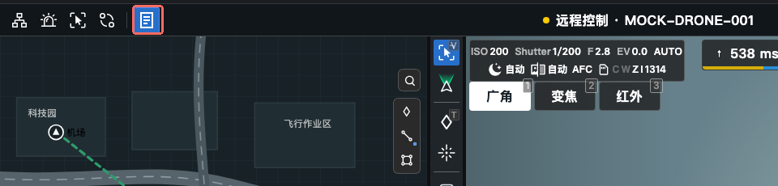

*红框是菜单动作入口，不是左侧面板。模拟界面。*

#### `cockpit.ui.live-overlay` —— 直播画面浮层

覆盖在直播画面上的浮动区块（叠加信息、自绘标记）。

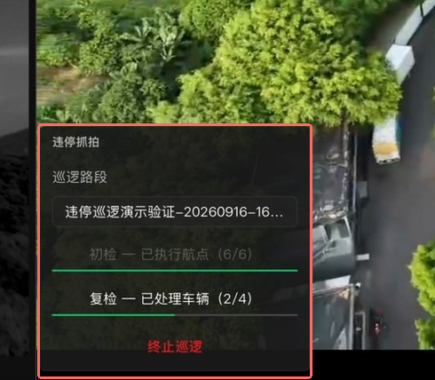

*红框内容叠在直播画面上；停在画面左下也不等于 `left-bottom-panels`。*

- `stream?`：指定挂在哪个直播画面上（主载荷、副载荷、FPV、机场等，取值见上表）。
- `overlayLevel`：`normal` 常规层 / `top` 顶层。
- `placement` + `width`/`height`/`offsetX`/`offsetY`/`top?`/`right?`/`bottom?`/`left?`：停靠方式与尺寸。默认 `visible=false`，插件自己控制何时显示。
- `interactive?`：是否接收鼠标事件；默认 `false`（点击穿透到直播画面）。
- `render()`：返回浮层内容的界面。

#### `cockpit.ui.left-panel` —— 左侧面板

驾驶舱左侧的可切换面板（一个页签）。默认 `visible=false`，用户从面板列表里打开，或插件用句柄的 `reveal()` 主动展开。

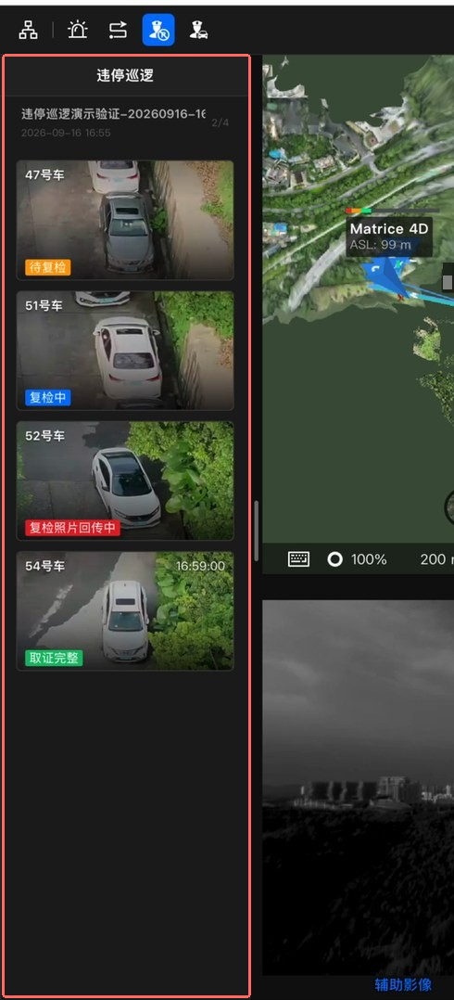

*红框整列为插件面板，右侧仍是宿主地图。*

- `label` / `icon?` / `width?`：页签文字、图标、面板宽度。
- `render()`：返回面板内容的界面。
- 句柄支持 `reveal()`：把面板在宿主界面中展开（见[贡献句柄](#改状态与撤销贡献句柄)）。

#### `cockpit.ui.sublive-tab` —— 子直播页签

子直播窗口的页签，字段与 `left-panel` 相同，句柄同样支持 `reveal()`。

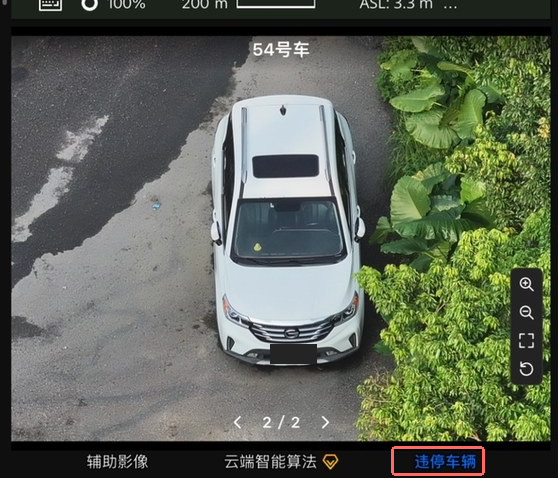

*红框为插件页签，照片是该页签内容，与原生页签并列。*

#### `cockpit.ui.left-bottom-panels` —— 左下角面板

驾驶舱左下角的功能面板。默认隐藏；`interactive` 默认 `true`。

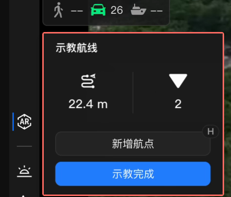

*红框是功能面板，不是整列左侧页签。*

注意：这类面板的展示还受宿主的载荷控制权约束——插件没有相机载荷控制权时，即使 `visible=true` 宿主也不会显示它。

#### `cockpit.ui.flight-actions` —— 飞控操作按钮

飞行控制操作区的按钮（返航等指令旁边）。字段与底部工具栏按钮类似，`anchor?` 支持插到"返航后"等锚点；`visible` 默认 `true`。

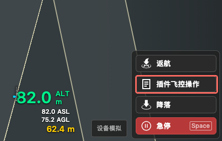

*红框插在“返航”之后、“降落”之前，即 `flight-actions:after-return-home`。模拟界面。*

#### `cockpit.ui.live-context-menu` —— 直播画面右键菜单项

用户在直播画面上右键时菜单里的一个条目。

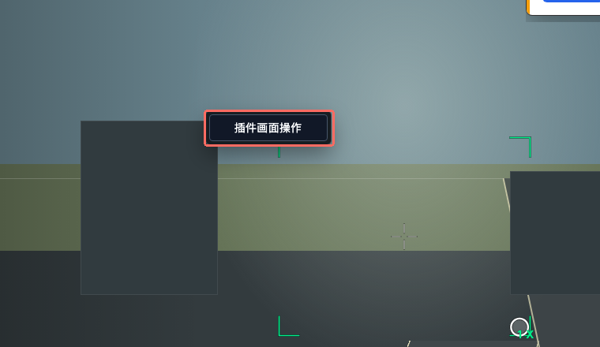

*右键后出现在点击位置附近，不是常驻工具栏按钮。模拟界面。*

- `onTrigger({relativePos, videoPoint, stream})`：回调里能拿到右键位置（相对画面与视频坐标）和当前画面类型，据此决定要执行的操作。
- `visible` 默认 `true`。

### 计划（plan）

#### `plan.form-extensions` —— 飞行计划表单扩展块

往飞行计划表单里追加一块自定义填写区域，随表单一起校验和提交。

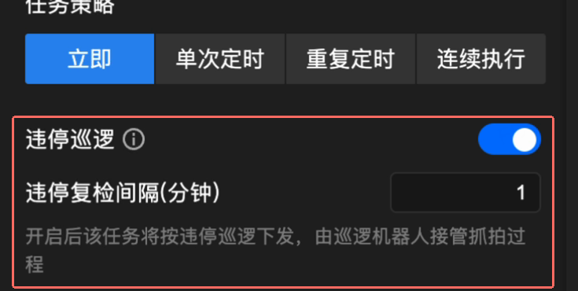

*上方是原生表单，红框是插件追加区域，即 `task-strategy:after`。*

- `anchor?`：`form-end`（表单末尾）或 `task-strategy:after`（任务策略之后）。
- `planType`：只在对应类型的计划里出现（`all` 表示全部）。
- **提交语义（重要）**：
  - 新建/复制计划：渲染你的块，提交时走 `validate(input)` → 通过后 `onSubmit(input)`。
  - 编辑已有计划：**不渲染**你的块，只调 `onEditSubmit(input)`——别在里面假设界面存在。
  - `validate` 返回失败会阻断原生表单提交。
- 业务扩展键（写入任务 `biz_ext` 的数据）≤64 字符、≤4KB，且与 `biz_ext` 其他使用方互斥。

### 项目（project）

#### `project.sidebar-actions` —— 项目侧边栏入口

项目页面左侧的导航入口，点击进入插件自己的页面。

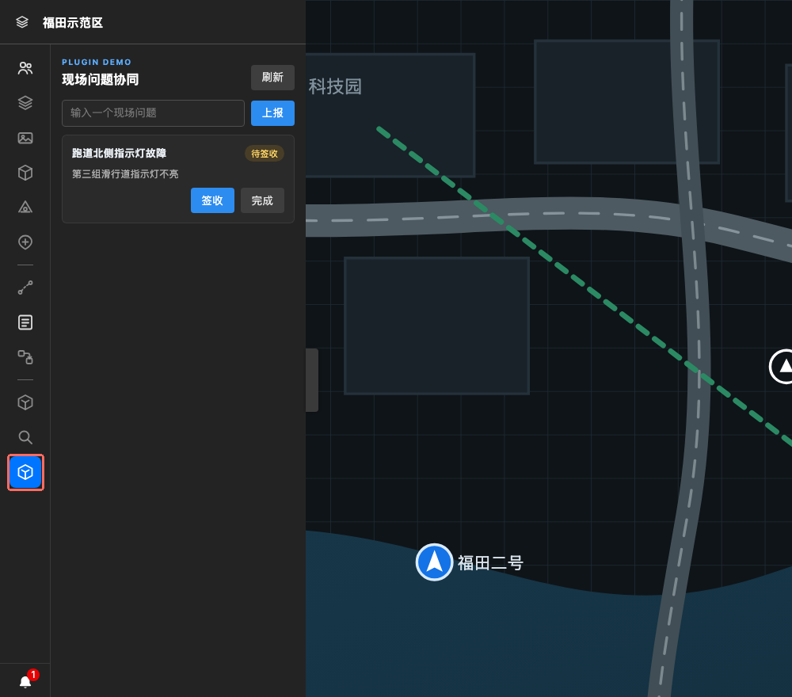

*红框是入口；点击后的右侧面板来自 `render()`，两者是不同区域。模拟界面。*

- `path`（静态字段，必填）：插件页面的路由，用户点击入口后进入该路由。
- `position?`（静态字段）：原生侧边栏菜单项的插入锚点索引，从 `0` 开始，入口插在对应原生项之前；省略或大于等于原生项数量时追加到末尾。它不是插件间的排序权重，同一锚点内仍按上方的多贡献顺序展示。
- `render()`：进入 `path` 后返回左侧插件路由面板的界面，不用于渲染入口图标。
- `renderWorkspace?()`：同一路由激活时，可另外返回右侧主工作区的界面；不提供时只渲染左侧面板。
- `icon` / `label` / `disabled` / `showBadge`（红点角标）都是运行时状态。宿主用 `icon` 指定的资源渲染原生侧边栏按钮的图标。

### 消息（message）

#### `message.alert-popups` —— 告警弹层卡片

消息中心的告警弹层。`render()` 返回卡片内容的界面，默认 `visible=false`，由插件控制何时弹出。

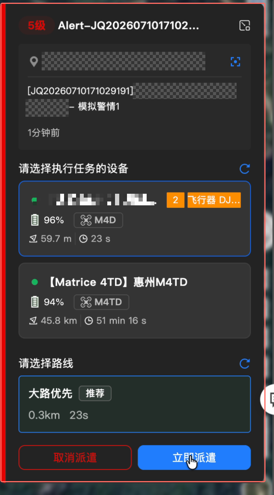

*红框整张卡片是插件界面，作为告警弹层显示。*

## 值域与校验说明

- `stream`：直播画面类型枚举，取值见目录表。
- `placement`：浮层停靠枚举，取值见目录表。
- CSS 长度只允许有限数字、零值、带合法单位的长度和 `calc/min/max/clamp`；拒绝 `url()`、`var()` 和关键字。

## 改状态与撤销：贡献句柄

`contribute()` 成功后返回一个对象，用来改这次贡献的状态（`update()`）或撤销它（`dispose()`）；下文把这个对象叫“句柄”。它只代表你提交的这一次贡献，不是宿主对象，也拿不到宿主其它界面。

```ts
const handle = await ctx.extensions.contribute('panel-entry', {
  icon: 'panel-icon', label: '面板', active: false, disabled: false,
  onTrigger: action => action.openView(ctx.views.get('panel')),
})

await handle.update({disabled: true, label: '暂不可用'})  // 更新状态
await handle.dispose()                                     // 撤销贡献
```

```ts
interface ExtensionHandle<TState> {
  readonly extensionId: string
  update(patch: Partial<TState>): Promise<void>
  dispose(): Promise<void>
}

// left-panel / sublive-tab 的句柄多一个 reveal()
interface RevealableExtensionHandle<TState> extends ExtensionHandle<TState> {
  reveal(input?: PluginValue): Promise<void>
}
```

没有同步 `get()`：读当前状态请自己保存，改状态只能 `update()`。

`reveal()` 的语义：只有 `left-panel` 和 `sublive-tab` 的句柄有这个方法，用于把面板展开到用户可见（等价于用户手动点开页签）；面板尚未提交或已 `dispose()` 时调用会失败。`input` 是传给面板界面的提示值，可省略。

## 操作上下文（`ActionContext`）

按钮类扩展点 `onTrigger` 的入参：

```ts
interface ActionContext {
  openView(view: ViewHandle, options?: {
    placement?: 'left' | 'right' | 'top' | 'bottom'
  }): Promise<ViewPresentation>
  notify(message: string, level?: 'info' | 'warning' | 'error'): Promise<void>
}
```

## 常见问题

| 现象 | 原因与处理 |
| --- | --- |
| `contribute()` 报 `EXTENSION_DECLARATION_INVALID` | 这个扩展 id 没在清单 `extensions[]` 里声明，或声明的扩展点不属于当前宿主；先声明再贡献 |
| `contribute()` 报 `HOST_RUNTIME_DISPOSED` | 激活登记阶段已结束（或运行时已停止）；`contribute()` 只能在 `activate()` 里调用 |
| `contribute()` 报 `REGISTRATION_CONFLICT` | 同一个扩展 id 贡献了两次 |
| 报声明不合法 | 清单里写了状态/方法或布局字段；静态字段以目录表为准 |
| `update()` 报 `HANDLER_STATE_INVALID` | patch 里有契约未声明的字段，或字段值类型非法 |
| `update()` 报 `EXTENSION_NOT_FOUND` | 句柄已 `dispose()` 或宿主已卸载；不要复用旧句柄 |
| 想查询当前 UI 状态 | 没有同步 get；自己在闭包里维护状态 |
