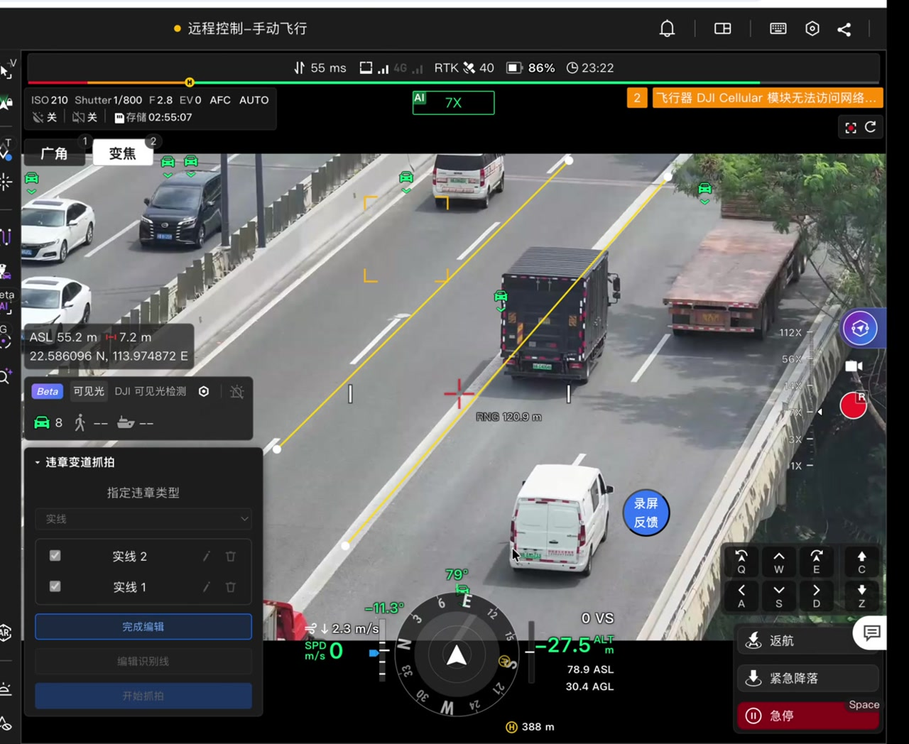

# 前端能力目录

能力是宿主提供给插件调用的功能：画地图标记、读遥测、控制云台……每个能力有一个 ID，同时就是权限名——在清单 `permissions` 里声明后才能用。目录封闭，以本页表格为准。

## 用法

```ts
// 1. 清单 permissions 声明 → 2. 获取 → 3. 判空 → 4. 调用
const map = await ctx.capabilities.get('platform:map')
if (!map) {
  ctx.logger.warn('当前宿主未提供地图能力')
  return
}
const marker = await map.addMarker({position: {lng: 113.9, lat: 22.5, height: 0}, label: '目标'})
await marker.dispose()   // 主动释放；插件停用时平台也会统一回收
```

`get()` 返回 `undefined` 的三种原因：权限没声明、当前宿主没提供该能力、运行环境不满足要求（如同源限制）。要按「能力缺失」降级处理，不要当网络错误重试。

## 能力可以组合成完整业务闭环

能力不是一张孤立的 API 清单。以变道抓拍为例，同一个插件按下面的顺序把驾驶舱能力接成业务链：

| 阶段 | 能力 / 接口 | 在变道抓拍中的用途 |
| --- | --- | --- |
| 运行门控 | `cockpit:context`、`cockpit:telemetry` | 校验项目、机场 SN、航次，以及载荷控制权、飞行模式和设备状态 |
| 识别准备 | `cockpit:ai-config` | 开启 `dji-visible` 和 `vehicle` 目标类型，配置未确认就不开始抓拍 |
| 画布标注 | `cockpit.ui.live-overlay`、`cockpit:live-pointer`、`cockpit:scene-geometry` | 在直播画面上自绘实线/导流区；绘制时接管指针；把画面点反投到地面锚定 |
| 逐帧检测 | `cockpit:detection` | `onFrame()` 消费 AI 检测帧；用 `frameId` 把地面标注投回当前帧，再把目标 `bbox` 和标线交给插件自己的规则 |
| 取证 | `cockpit:camera`、`ctx.blobs` | 命中后用 `captureFrame()` 截当前直播帧，叠加标线与涉事车辆 `bbox` 后存为证据 |
| 记录与提示 | `ctx.apiCall`、`platform:notification` | 用稳定 `event_key` 建事件、去重；刷新记录并通过通知提示用户 |

关键点是：**压线/进入规则由插件自己算，宿主只提供状态、画面和逐帧检测。** `cockpit:detection` 给的是带 `capturedAt`（AI SEI 时间）和归一化 `bbox` 的检测帧，不是“已经判好的违章事件”。插件可以在这份结果上做几何判断、截帧、叠绘和上报，也可以只把其中一部分能力用在别的业务里。


*黄色实线与白色顶点是插件通过 `live-overlay` 自绘并锚定到地面的标注；绿色框和车辆 ID 是驾驶舱原生 AI 检测显示，插件通过 `cockpit:detection` 读取同一路帧。扩展点只是容器，业务判断发生在插件入口里。*

完整的运行时链路和截图见[交通抓拍](../../50.examples/50.traffic-capture.md#驾驶舱里的运行链路)。

## 目录

<!-- FH2-KB:BEGIN frontend-capability-catalog -->
「可用宿主」是平台登记的提供方；插件仍需处理 `get()` 返回 `undefined`（未声明权限、宿主未接线、环境不满足都会出现）。

| ID / 权限名 | 获取方式 | 限制 | 可用宿主 | 方法 |
| --- | --- | --- | --- | --- |
| `platform:http` | `ctx.apiCall` | — | 全部宿主 | `call` |
| `platform:events` | `ctx.events` | — | 全部宿主 | `on` |
| `platform:websocket` | `ctx.ws` | — | 全部宿主 | `onBizCode` |
| `platform:storage` | `ctx.storage / ctx.blobs` | — | 全部宿主 | `blobs`、`local`、`session` |
| `platform:navigation` | `ctx.capabilities.get('platform:navigation')` | — | 驾驶舱、项目、消息 | `back`、`open` |
| `platform:location` | `ctx.capabilities.get('platform:location')` | — | 驾驶舱、项目 | `getState`、`onStateChanged` |
| `platform:wpmz` | `ctx.capabilities.get('platform:wpmz')` | — | 全部宿主 | `parseCoordinates`、`rewrite` |
| `platform:audio` | `ctx.capabilities.get('platform:audio')` | — | 全部宿主 | `createPlayer` |
| `platform:clipboard` | `ctx.capabilities.get('platform:clipboard')` | — | 全部宿主 | `writeText` |
| `platform:notification` | `ctx.capabilities.get('platform:notification')` | — | 驾驶舱、项目、消息 | `show` |
| `platform:dialog` | `ctx.capabilities.get('platform:dialog')` | — | 全部宿主 | `open` |
| `platform:map` | `ctx.capabilities.get('platform:map')` | — | 全部宿主 | `addBillboard`、`addLabel`、`addMarker`、`addPolygon`、`addPolyline`、`onClick`、`onHover`、`recenter`、`registerContextMenuItem` |
| `platform:wayline-preview` | `ctx.capabilities.get('platform:wayline-preview')` | — | 全部宿主 | `show` |
| `platform:object-upload` | `ctx.capabilities.get('platform:object-upload')` | 同源页面 | 驾驶舱 | `upload` |
| `platform:devices` | `ctx.capabilities.get('platform:devices')` | — | 全部宿主 | `getProjectDevices` |
| `cockpit:context` | `ctx.capabilities.get('cockpit:context')` | — | 驾驶舱 | `getState`、`onStateChanged` |
| `cockpit:camera` | `ctx.capabilities.get('cockpit:camera')` | — | 驾驶舱 | `acquireRecording`、`boundingZoom`、`captureFrame`、`ensureMode`、`ensureZoom`、`getState`、`onStateChanged`、`switchLens`、`takePhoto` |
| `cockpit:telemetry` | `ctx.capabilities.get('cockpit:telemetry')` | — | 驾驶舱 | `getState`、`onStateChanged` |
| `cockpit:detection` | `ctx.capabilities.get('cockpit:detection')` | — | 驾驶舱 | `onFrame`、`projectFromGround`、`projectToGround` |
| `cockpit:ai-config` | `ctx.capabilities.get('cockpit:ai-config')` | — | 驾驶舱 | `ensure`、`getState`、`onStateChanged` |
| `cockpit:scene-geometry` | `ctx.capabilities.get('cockpit:scene-geometry')` | — | 驾驶舱 | `projectGeoToVideo`、`projectSnapshotGeoToVideo`、`projectSnapshotVideoToGround`、`projectVideoToGround`、`releaseSnapshot` |
| `cockpit:live-pointer` | `ctx.capabilities.get('cockpit:live-pointer')` | — | 驾驶舱 | `acquire` |
| `cockpit:flight-control` | `ctx.capabilities.get('cockpit:flight-control')` | — | 驾驶舱 | `acquireControl`、`emergencyStop`、`flyTo`、`releaseControl`、`returnHome`、`returnHomeCancel` |
| `cockpit:gimbal` | `ctx.capabilities.get('cockpit:gimbal')` | — | 驾驶舱 | `lookAt`、`reset` |
| `cockpit:hotkeys` | `ctx.capabilities.get('cockpit:hotkeys')` | — | 驾驶舱 | `register` |
| `cockpit:smart-track` | `ctx.capabilities.get('cockpit:smart-track')` | — | 驾驶舱 | `getState`、`onStateChanged`、`start`、`stop` |
| `cockpit:flight-task` | `ctx.capabilities.get('cockpit:flight-task')` | — | 驾驶舱 | `cancelInFlightWayline`、`getState`、`onStateChanged`、`startInFlightWayline` |
| `project:context` | `ctx.capabilities.get('project:context')` | — | 项目 | `getState`、`onStateChanged` |
| `plan:form-context` | `ctx.capabilities.get('plan:form-context')` | — | 计划 | `getState`、`onStateChanged` |
<!-- FH2-KB:END frontend-capability-catalog -->

## 默认值与注意点

| 项 | 说明 |
| --- | --- |
| `camera.captureFrame()` | `requireGeometry` 默认 `true`（无几何信息时不拍） |
| `notification.show()` 的 `durationMs` | 无 SDK 默认值，由宿主决定 |
| 地图 `clampToGround` | 缺省 `false` |
| 音频 `source` | 支持 `preset`、绝对/受控 URL 或插件内 `./` 资源 |
| `platform:devices` | 未知机型返回 `model.id: 'unknown'`，缺角色为 `null`；不要猜测设备关系 |
| 能力「可用」≠ 操作成功 | 飞控、设备类操作还要检查控制权、机型与链路；`accepted` 只是受理 |

## 常见问题

| 现象 | 原因与处理 |
| --- | --- |
| `get()` 一直返回 `undefined` | 清单 `permissions` 没声明，或当前宿主确实没提供（对照上表提供方列） |
| 用 `ctx.capabilities.get('platform:map')` 报错或拿不到 | `platform:http/events/websocket/storage` 是内建能力，不在 `get()` 范围内，直接用 `ctx` 顶层成员 |
| `get()` 成功但命令没生效 | 能力可用不代表设备最终执行成功；查询权威状态确认 |
| 报 `CAPABILITY_NOT_AVAILABLE` | 权限或运行环境不满足；修正声明或降级 |
