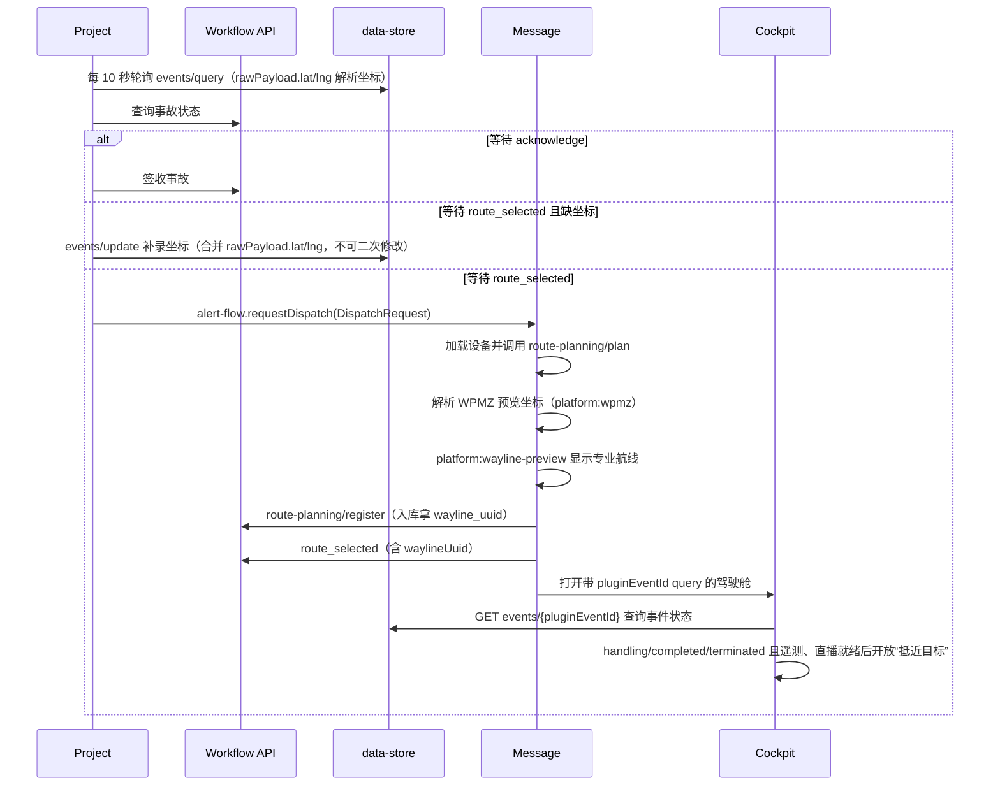

# 事故快处插件架构

## 从哪里开始读

这个插件按前端开发者熟悉的职责组织：

1. 先读 `src/workflow/workflow-status.ts`，了解后端状态如何变成用户动作。
2. 再读 `src/workflow/incident-actions.ts` 和 `src/workflow/dispatch-session.ts`，了解签收、派遣与失败恢复。
3. 坐标补录的守卫与 event 接口写入在 `hosts/project/list-controller.ts`。
4. 最后读三个 `src/hosts/*/activate.ts`，了解这些流程如何接入 Project、Message 和 Cockpit。

## 完整业务链路

Project 列表以 HTTP 轮询（10 秒）兜底，并可通过 `scene_alert/alert_notify` 即时刷新；Message 派遣卡片
由 Project 列表「立即派遣」经动态可选的 `alert-flow` Service 打开。Message 缺席不阻断 Project 激活。
三个 Host 分别直接消费 `platform:wayline-preview`，不经另一个 UI Host 转发专业航线预览。

## 目录职责

| 目录 | 负责 | 不负责 |
|---|---|---|
| `api/` | URL、请求体、响应信封和后端字段转换 | Vue 状态、Host Capability |
| `workflow/` | 事故类型、状态决策、签收/派遣/到达流程、平台航线预览适配 | Extension 注册、界面渲染 |
| `services/` | `alert-flow` 跨 Host 协议 | HTTP 请求、宿主专业航线渲染 |
| `hosts/` | 获取 Capability、装配依赖、注册资源并释放 | 解析后端 JSON、重复业务决策 |
| `views/` | Vue 页面和 View contract | 直接请求后端或调用 Host Capability |
| `experimental/` | 临时 Cockpit SDK 验证 | 正式事故处置逻辑 |

依赖方向是 `plugin → hosts → api/workflow/services/views`。不同 `hosts/*` 之间禁止源码导入。

## 工作流状态

| 后端状态 | 前端动作 | 所在代码 |
|---|---|---|
| `awaitingSignal=acknowledge` | 签收并刷新 Project 列表 | `workflow/incident-actions.ts` |
| `awaitingSignal=route_selected` 且缺坐标 | 卡片补录坐标（`events/update` 写 rawPayload.lat/lng） | `hosts/project/list-controller.ts` |
| `awaitingSignal=route_selected` | 请求 Message 展示派遣卡片 | `workflow/incident-actions.ts` |
| `signal=ignore` | 仅已签收警情可忽略，成功后退出活动列表 | `hosts/project/list-controller.ts` |
| `event.status=handling` | Cockpit 继续轮询并开放“抵近目标” | `workflow/cockpit-monitor.ts` |
| `event.status=completed/terminated` | Cockpit 停止轮询并开放“抵近目标” | `workflow/cockpit-monitor.ts` |
| `event.status=ack_timeout/ignored` | Cockpit 停止轮询并隐藏事故入口 | `workflow/cockpit-monitor.ts` |
| 其他信号 | 明确提示，不猜测新的后端语义 | `workflow/workflow-status.ts` |

Message 卡片内部的 `idle → pending → dispatching → dispatched/closed` 由
`workflow/dispatch-session.ts` 管理。设备默认不选、按距离升序排列，选中设备后自动规划路线并默认选
第一条；设备和路线选齐前「立即派遣」保持禁用，`dispatch()` 在 Entry 层再次拒绝。点击「立即派遣」时
先对选中航线调用 `route-planning/register` 拿 `wayline_uuid`（plan 已回填时跳过），再发送带
`waylineUuid` 的 `route_selected`。

警情列表 data-store query 使用 7 态：`unacknowledged → acknowledged → handling → completed`，以及终态
`ack_timeout / ignored / terminated`。Project 工作流动作只由 `awaitingSignal` 与 `currentStep` 决定；Cockpit
不再查询 workflow status，而是按 URL `pluginEventId` 查询单事件并严格校验七态。警情坐标只来自 `rawPayload.lat/lng`
（`poi` 字段已废弃不读，缺失坐标即 `(0,0)` 判定为无坐标），人工反馈仅在 acknowledged/handling 显示，
通过 data-store update 把 `correction_note` 合并回原 `rawPayload`；忽略仅在 acknowledged 显示。

## 全部事件列表：媒体库与飞行记录跳转

事件顶层新增 `flightMissionId`（与 `eventId` 同级）：真实后端语义是 es-workflow 执行 command_task
节点时，把 平台任务服务 创建飞行任务返回的任务 uuid 原样作为 executionTask uuid 存库，它天然就是飞行记录页
`#/flight-path?id=` 需要的飞行任务 id。插件在 `parseAccidentEvent` 解析该顶层字段并透传到
`AllEventItem`，未派遣警情没有该字段。

跳转链路对齐原生事故快处 `useFlightActions`（宿主原生自动工作流工具）：

| 动作 | 数据来源 | URL（`platform:navigation` target=blank） |
|---|---|---|
| 飞行记录 | `AllEventItem.flightMissionId` | `/organization/{orgId}/project/{projectId}#/flight-path?id={flightMissionId}` |
| 媒体库 | `flightMissionId` 二次请求 `GET /task/api/v2/workspaces/{projectId}/flight-tasks/detail?flight_task_id=` 取 `data.folder_id` | `/organization/{orgId}/project/{projectId}#/media?pid={folderId}` |

- View（`AllEventsDialog.vue`）操作列渲染「媒体库」「飞行记录」文字按钮：可用 `#268AFF`、
  置灰 `#5C5D60`；每个含 `flightMissionId` 的行挂载即查 folderId（Map 缓存，同一任务只查一次）。
- 「飞行记录」有 `flightMissionId` 即可点；「媒体库」拿到 folderId 才可点，未就绪时置灰。
- folderId 查询失败（含 dev Mock 网关暂无该端点的 404）在 controller 静默降级为 null，不弹错误通知。
- `platform:navigation` 用唯一 `capabilities.get` 获取：宿主未提供时返回 `undefined`，降级为 no-op 并告警。
