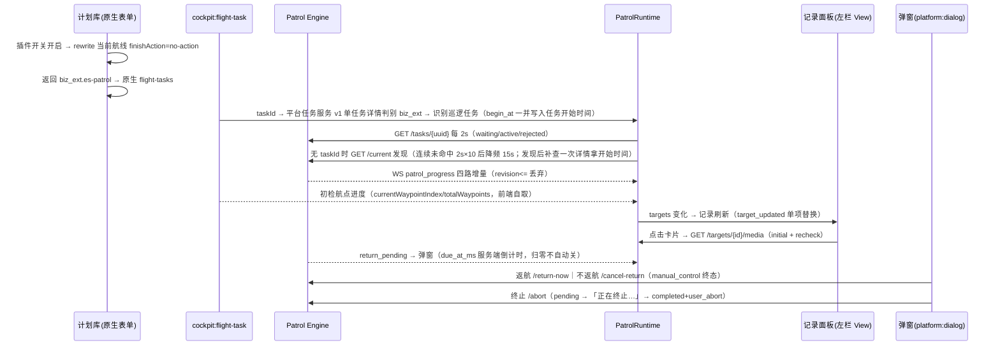

# 违停巡逻插件架构

## 从哪里开始读

Cockpit 代码遵循一条单向数据流：

```text
flight-task / context / HTTP / WS
                 ↓
          PatrolRuntime
                 ↓
        PatrolTaskState
                 ↓
    Presentation / UI Controller
                 ↓
        Plugin View / Host UI
```

推荐阅读顺序：

1. `src/hosts/cockpit/patrol-runtime.ts`：外部数据怎样进入插件，以及任务识别、轮询和生命周期如何协作。
2. `src/workflow/patrol-session.ts`：HTTP 权威快照与 WS 增量如何合并为任务状态。
3. `src/hosts/cockpit/task-view.ts`：任务状态怎样转换为任务面板和记录面板数据。
4. `src/hosts/cockpit/evidence-preview.ts`、`patrol-dialog-controller.ts`：用户操作及局部 UI 生命周期。
5. `src/hosts/cockpit/activate.ts`：Capability、Extension、View、Runtime 和 Controller 的装配关系。

`activate.ts` 不实现任务识别、轮询或报文合并；读者不需要从一个大函数里还原业务流程。

## Cockpit 模块职责

| 模块 | 负责 | 不负责 |
|---|---|---|
| `activate.ts` | 创建依赖、注册 View/Extension、连接状态与 Controller、统一卸载 | 任务识别、HTTP/WS 合并、业务状态转换 |
| `patrol-runtime.ts` | context/flight-task、任务识别、HTTP 轮询、WS、航点进度、路段查询、迟到响应保护 | Vue、View contract、弹窗和地图交互 |
| `patrol-session.ts` | 纯状态转换、revision/phase 守卫、派生判断 | 网络请求、Timer、Capability |
| `task-view.ts` | `PatrolTaskState` 转任务面板状态、记录面板更新、Overlay 尺寸 | 请求路段、修改业务状态 |
| `evidence-preview.ts` | 卡片选中、媒体加载、Preview Tab 与地图联动 | 任务轮询、返航/终止命令 |
| `patrol-dialog-controller.ts` | 弹窗、倒计时、返航/终止动作及按钮状态 | 任务识别、WS 分发 |
| `map-preview.ts` | 当前证据图钉和地图居中 | 记录选择和媒体请求 |

### 状态所有权

- `PatrolRuntime` 是 `PatrolTaskState` 的外部数据写入入口；HTTP 为权威全量，WS 只做增量。
- `recordsState.activeTargetId` 是当前证据选择的唯一事实源，预览模块不维护第二份目标 ID。
- View 只接收可渲染状态并调用 contract 方法，不访问 HTTP、WS、Capability 或任务状态机。
- 用户动作由对应 Controller 调用 API；需要确认服务端终态时调用 `runtime.refresh()` 回到同一数据流。
- Runtime 使用一个任务 generation 丢弃切换任务或卸载后的迟到响应，不建立通用取消框架。
- View、Extension、Capability、WS 和 Timer 句柄由 Engine `ResourceTracker` 自动回收；插件 teardown
  只关闭弹窗、地图等业务状态，并释放 `taskState.subscribe()`、Mock 回调等 Engine 不可见的本地资源。

## 业务链路（新版契约）



## 目录职责

| 目录 | 负责 | 不负责 |
|---|---|---|
| `api/` | Engine 六接口 + 平台任务服务/wayline 详情、响应信封、DTO 防御解析 | Vue 状态、Extension 注册 |
| `mock/` | 内存后端、剧本推进、证据图片生成、动作异步收敛 | 正式业务决策 |
| `workflow/` | link_state/phase 状态机、revision 守卫、记录构建 | Capability、Vue、Extension |
| `hosts/` | Runtime、Capability/Extension 装配和 UI Controller | 解析后端 JSON、Vue 渲染 |
| `views/` | Vue UI 和 View contract | HTTP、WS、地图调用 |

依赖方向是 `plugin → hosts → api/mock/workflow/view contracts`。

## Point / Capability 消费

| 通道 | 用途 |
|---|---|
| `cockpit.ui.menubar` | Mock 专用剧本推进入口（图标 `patrol-icon`，manifest `contributes.icons` 贡献）：仅 enableMock=true 时贡献，每次点击推进剧本一步；enableMock=false 不显示该按钮，面板打开只走任务到达 reveal 或宿主侧栏入口 |
| `cockpit.ui.left-panel` | 抓拍记录面板（`visible:true` 常驻 + `width:260` 声明初始宽与拖拽下限；静态分组头 + 车辆卡片；产品变更：只展示当前在飞任务，无历史架次与折叠交互，任务结束后数据保留至下一轮；无任务时空态展示「暂无抓拍记录」；分组头时间为任务开始时间，来自 平台任务服务 详情 `begin_at`（激活时一次性写入 `startedAtMs`，缺失显示 `--`），不依赖复检拍照时间） |
| `cockpit.ui.sublive-tab` | 「违停车辆」证据预览（多图分页 + 缩放旋转） |
| `cockpit.ui.live-overlay` | 直播左下角 280px 任务面板（DronePayload 流，bottom-left 偏移 4/-16）；必须在无载荷控制权时继续展示，不能迁入受 `hasPayloadCtl` 门控的 `left-bottom-panels` |
| `plan.form-extensions` | 计划表单违停巡逻开关（planType=normal，仅新建/复制展示，`anchor: task-strategy:after` → 任务策略配置区之后）；开启时 onSubmit 先改写当前生成航线，再返回 `{ biz_ext: { 'es-patrol': {} } }`（关闭返回 `{}` 且不调用 WPMZ）；复制经 `sourceBizExt` 继承开关；编辑不显示插件 UI，由可选 `onEditSubmit` 自行识别草稿 `biz_ext.es-patrol` 并恢复 NO_ACTION，宿主不感知该业务 key；任务仍走原生 flight-task API |
| `platform:dialog` | 终止巡逻确认 + 返航决策弹窗（hideHeader，288 宽自绘 248 高；倒计时来自服务端 due_at_ms） |
| `platform:map` | 证据照片 Billboard（48×54 图钉）+ recenter |
| `platform:notification` | 拒绝原因 / 取消返航 / 动作失败提示 |
| `platform:wpmz` | Plan 开启提交时对当前 `wayline_uuid` 调用 `rewrite()`，仅设置 missionConfig `finishAction: 'no-action'`；不向 Plan UI 暴露或保存动态完航动作状态 |
| `plan:form-context` | Plan 开关 View 订阅表单草稿快照（多航线自动关闭开关、sourceBizExt 复制继承、context 可用性） |
| `cockpit:flight-task` | 真实模式任务识别（`wayline.taskId` → 平台任务服务 biz_ext 判别）+ 初检航点进度（`wayline.completedWaypointCount/totalWaypointCount`）；复检即时航线走 `inFlightWayline` 通道，不消费 |
| `cockpit:context` | 真实模式 projectId / gatewaySn（WS dock 过滤 + /current 发现） |
| `ctx.apiCall` | Engine `/plugin-scene/api/v1/patrol/**` + 平台任务服务 v1 单任务详情 + wayline 详情（经插件网关，enableMock=false） |
| `ctx.ws.onBizCode` | `patrol_progress`（sub_biz_code 四路：progress/target_updated/return_pending/return_state） |

## 返航 / 终止链路（后端排队语义）

```text
立即返航：allowed_actions 含 return_now → POST /return-now（200=信号收下）
          → 实际结果看 return_home_state（pending → sent/failed）
不返航  ：allowed_actions 含 cancel_return → POST /cancel-return
          → phase=manual_control 终态（飞机人工操控，UI 明确提示）
终止巡逻：allowed_actions 含 abort → POST /abort（effective=immediate|pending）
          → pending 时按钮「正在终止…」；终态 completed + completion_reason=user_abort 显示「已终止」
```

前端不再抢控制权、不再急停（旧 `end-task.ts` 已删除，`cockpit:telemetry` /
`cockpit:flight-control` 权限已移除）。返航倒计时归零不自动关弹窗，等
`return_state` 或轮询状态变化。

## 数据源切换

`enableMock`（config，默认 **true**，当前仅用于测试与联调；后续会整体删除，不作为正式架构）：

- **true**：内存 Mock 后端（`mock/patrol-source.ts`），实现同一 PatrolApi + 事件总线
  （任务到达 / 四类 WS / 航点进度）；动作接口「下一次 getTask 收敛」模拟服务端异步生效。
- **false**：真实链路（`api/patrol-api.ts` 经 `ctx.apiCall` 插件网关）：
  `cockpit:flight-task.wayline.taskId` → 平台任务服务 v1 单任务详情 `biz_ext` 判别 → Engine `/tasks/{uuid}`
  每 2s 轮询 + WS 四路增量；无已激活任务时经 `/current?dock_sn` 发现（定时巡逻/刷新/他人操作）。
  复检即时航线在 `inFlightWayline` 通道独立承载，不进入巡逻任务识别；`flightId` 只用于判定航次
  切换——跨航次（含 taskId 尚未变化的窗口）立即释放已激活任务，taskId 清空则保留回顾数据。
  控制状态由 `patrol-runtime-machine.ts` 显式描述；任务详情最多尝试 3 次，失败后等待 task/project
  变化或显式刷新，不再无上限请求。普通轮询失败采用有上限的间隔退避，成功后恢复 2s。
  冷启动时 `flight-task` 已是 completed/failed，或 `/current` 首次返回终态快照，均不激活历史巡逻；
  当前驾驶舱会话内已激活任务的 taskId 清空或任务进入终态时仍保留 panel 与回顾数据，直到用户关闭、
  新任务替换、项目切换或页面刷新；只保存在内存，不做持久化。

## 暂缓项（本轮明确不做）

- 航线示教（Footer 入口 + 示教面板 + 确认弹窗 + H 快捷键）。
- Plan 表单开关与巡逻链路的 e2e/Mock Host 提交链路验证（用户决策：单测覆盖即可）。
- 旧版「任务成功后创建违停抓拍地图图层组」副作用（用户决策不保留）。
- Menubar 未读红点（Point 契约无 badge 字段）。
- 记录面板关键词/日期筛选、拖宽、图片 404 退避重试。
- 插件静态资源部署与后端目录登记（另行处理）。

## 样式与交互基线（2026-08-31 用户确认）

- 原生样式权威来源：宿主原生仓（违停巡逻 demo 分支）
  `src/components/ai/{patrol-task,auto-capture,capture-preview}/`；主题 Token 实际值取自
  宿主设计系统 token 与色彩定义（插件 iframe 内不可用宿主 CSS 变量，
  统一硬编码：red-6 #E41F29、orange-6 #FF9F0A、blue-6 #0075FF、bg-secondary #1F1F1F、
  component-secondary #2A2A2A、记录面板头部 #282828 + 边框 #393939）。
- 侧边栏产品变更（用户确认）：只展示当前在飞任务的数据，不展示历史架次，无展开/收起折叠；
  保留静态分组头（路段名 + 进行中蓝点 + 时间 + n/n 统计）；任务结束后数据保留至下一轮任务。
- SubLive 图片查看器工具栏对齐原生 CaptureImageViewer：右下角组合式 4 操作
  （放大/缩小/全屏/旋转，bottom:60px 避开分页器），双击复位替代原生 viewerjs 的隐式复位。
- 任务面板（2026-09-01 新版契约）：巡逻路段只读展示（航线在计划库选定）；waiting 显示
  「正在准备巡逻…」；rejected 显示四种拒绝原因文案（飞行任务仍会正常执行）；终态结论按
  completion_reason 区分（任务完成/已终止/未接管/已转人工控制/失败）。
